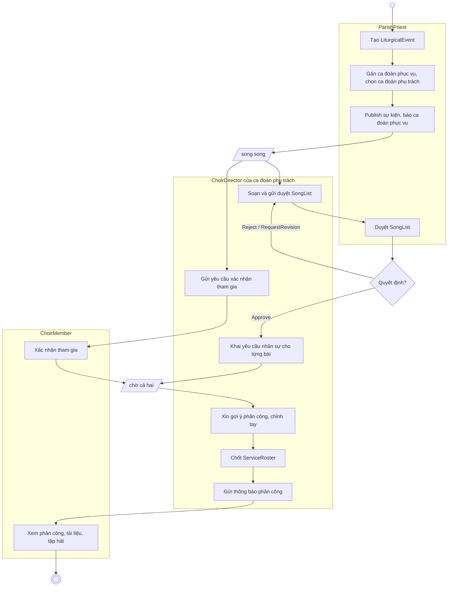
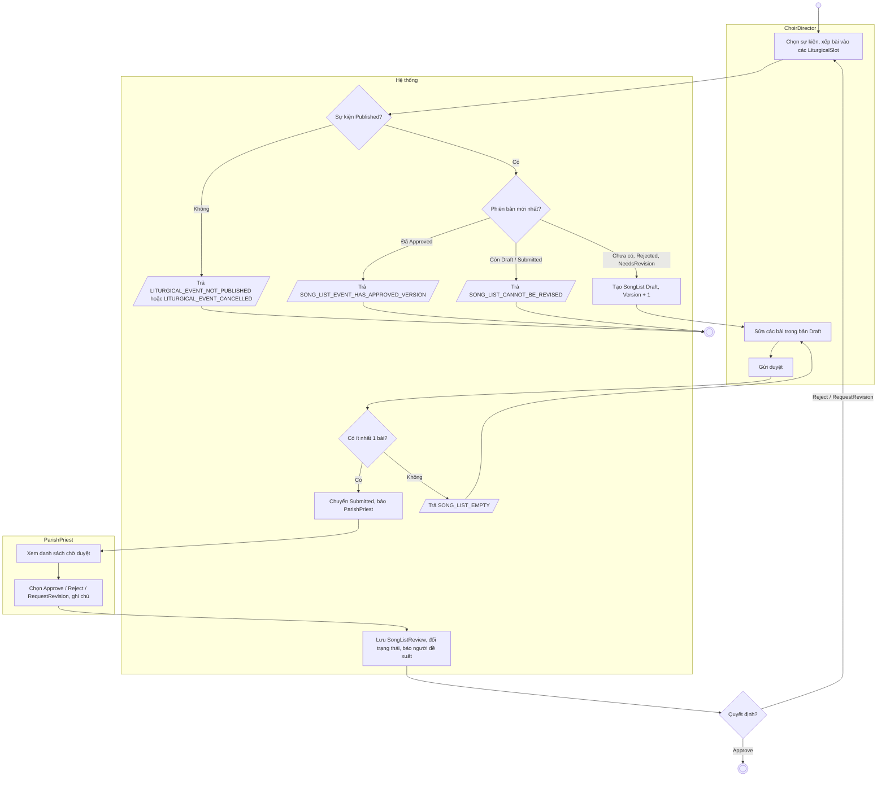
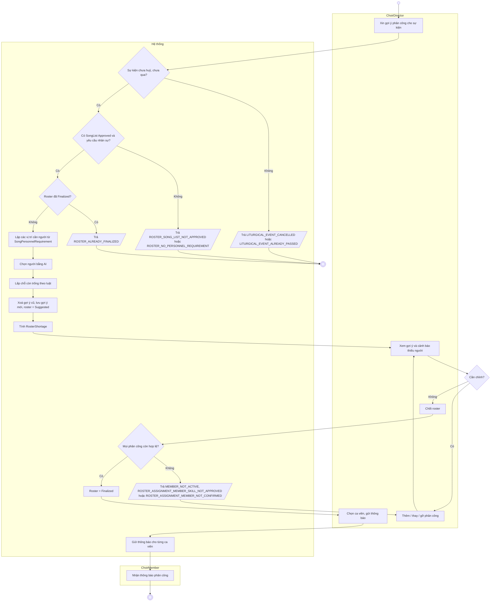
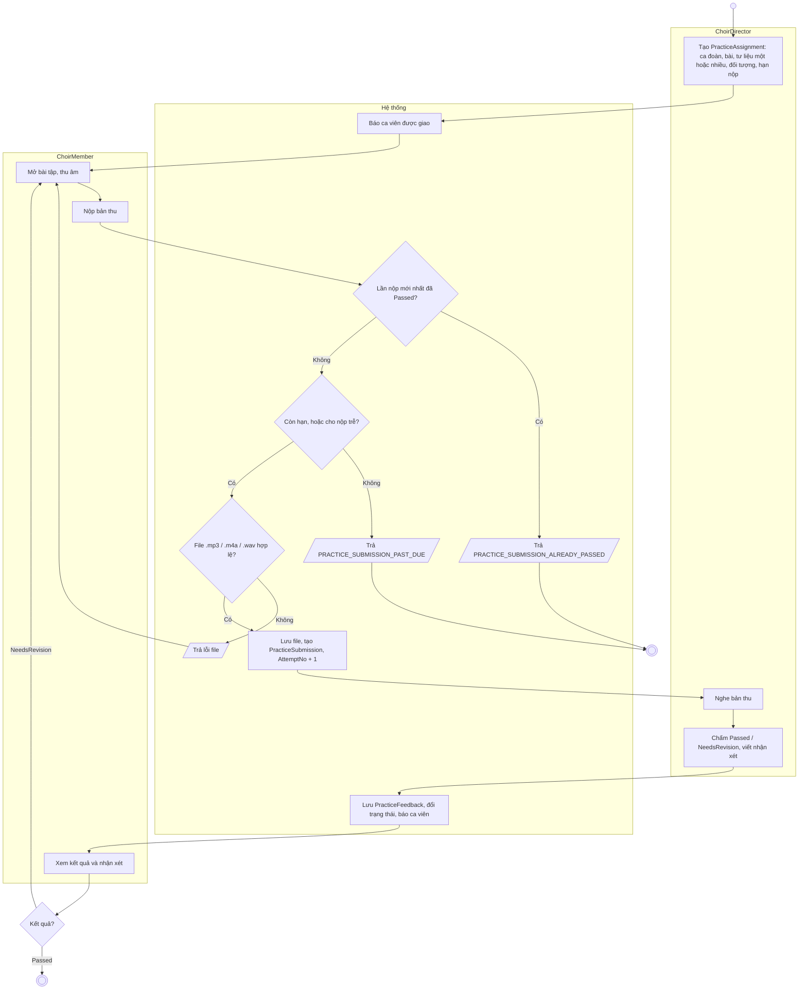
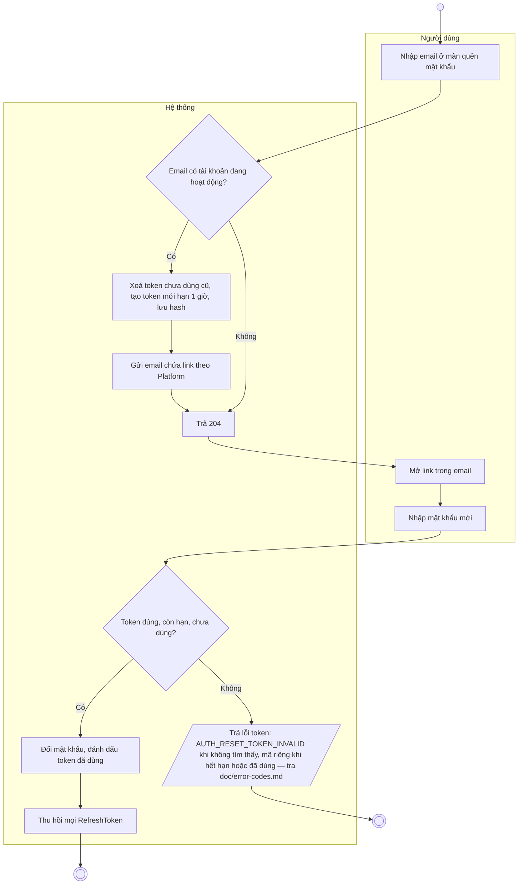
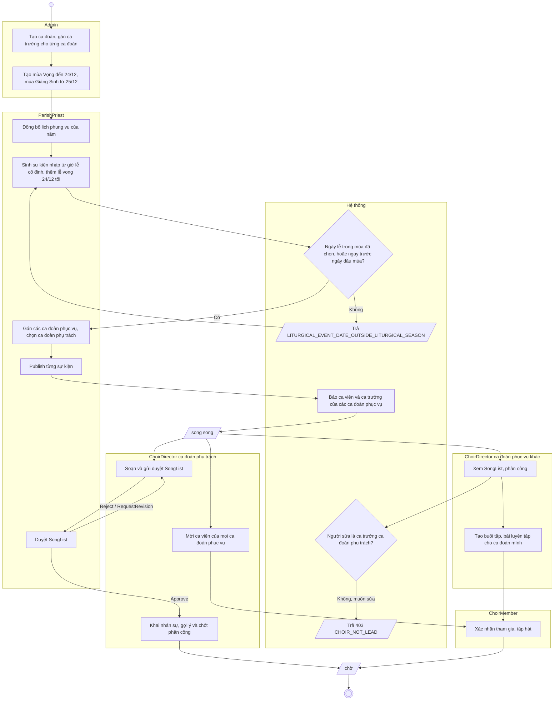

# Hướng dẫn vẽ Activity Diagram cho Harmonia

Tài liệu này chỉ cách vẽ activity diagram (UML Activity) cho các use case của Harmonia,
kèm sơ đồ mẫu đã đối chiếu với code ngày 2026-10-12.
Đi cùng `harmonia-state-diagram-guide.md`: state diagram trả lời "một bản ghi đi qua
những trạng thái nào", activity diagram trả lời "ai làm bước gì, theo thứ tự nào".

Sơ đồ nộp báo cáo thì **vẽ tay** (draw.io, Astah, Visual Paradigm hoặc giấy) theo mục 3.
Các khối Mermaid ở mục 4 chỉ là **hình mẫu để nhìn theo** — mở Markdown Preview trong
VS Code hoặc dán vào <https://mermaid.live> để xem hình. Mermaid không có activity diagram
thật nên hình mẫu dùng khung chữ nhật thay swimlane và ô chữ "song song" thay thanh
fork/join; khi vẽ tay phải dùng đúng ký hiệu UML ở bảng dưới.

## 1. Use case nào cần activity diagram

Chỉ vẽ cho use case có **rẽ nhánh** hoặc **nhiều actor chuyền việc cho nhau**.
Use case chỉ xem dữ liệu (UC-01, UC-02, UC-04, UC-06, UC-14, UC-16, UC-18, UC-35...) không cần.

| Sơ đồ | Use case | Vì sao đáng vẽ |
|---|---|---|
| Chuẩn bị một sự kiện (tổng) | UC-12 → UC-22 → UC-13 → UC-24…UC-27 | Ba actor chuyền việc, là luồng chính của hệ thống |
| Đề xuất và duyệt danh sách bài hát | UC-22, UC-13 | Vòng lặp sửa – duyệt, có phiên bản |
| Gợi ý và chốt phân công | UC-25, UC-25a, UC-25b, UC-26, UC-27 | Nhiều điều kiện, có AI và luật dự phòng |
| Nộp và chấm bài tập | UC-09, UC-10, UC-29 | Vòng lặp nộp lại, có hạn nộp |
| Khai và duyệt kỹ năng | UC-03, UC-19 | Hai actor, hai kết cục |
| Quên mật khẩu | S-03 | Luồng bảo mật, có token hết hạn |
| Tạo tài khoản | UC-31 | Sinh mật khẩu, gửi mail, bắt đổi mật khẩu |
| Lễ Giáng Sinh nhiều ca đoàn | UC-37, UC-32, UC-12, UC-12E, UC-39, UC-22, UC-23, UC-20 | Năm actor, mùa lệch một ngày cho lễ vọng, ca đoàn phụ trách (D8) |

## 2. Quy trình vẽ một sơ đồ

1. **Lấy phạm vi** từ `doc/harmonia-use-case-descriptions.md`: mã use case, actor,
   điểm bắt đầu và kết thúc.
2. **Xác định swimlane**: một lane cho mỗi actor tham gia, thêm một lane `Hệ thống`.
   Tên lane dùng đúng tên role: `ParishPriest`, `ChoirDirector`, `ChoirMember`, `Admin`.
3. **Liệt kê hành động của actor**: mỗi lời gọi API là một hành động — tra route ở
   `doc/api.md` hoặc `src/Harmonia.API/Controllers/`.
4. **Liệt kê hành động của hệ thống**: mở method service tương ứng trong
   `src/Harmonia.Application/Services/`, đọc từ trên xuống. Mỗi khối việc (kiểm tra,
   lưu, gửi thông báo) là một hành động.
5. **Tìm nút quyết định**: mỗi `if (...) return Result.Failure(ErrorCodes.X)` là một
   hình thoi. Gộp các guard cùng tính chất (ví dụ ba kiểm tra về sự kiện) thành một hình thoi.
6. **Tìm việc song song**: thông báo gửi cho nhiều người, hoặc hai actor làm việc độc lập
   (ca viên xác nhận tham gia trong khi ca trưởng soạn danh sách).
7. **Vẽ luồng chính trước** (happy path) từ trên xuống, sau đó mới thêm nhánh lỗi.
8. **Đối chiếu ngược**: mỗi hình thoi chỉ được tới một guard trong code, mỗi hành động
   của hệ thống chỉ được tới một đoạn trong service.

## 3. Cách vẽ tay

### Hình cần dùng

| Phần tử | Hình vẽ | Trong hình mẫu Mermaid |
|---|---|---|
| Nút bắt đầu | Chấm tròn đen đặc — đúng một nút | Vòng tròn nhỏ |
| Nút kết thúc | Chấm đen nằm trong vòng tròn — có thể nhiều nút | Vòng tròn kép |
| Hành động | Hình chữ nhật **bo góc**, ghi động từ + bổ ngữ ("Gửi duyệt") | Hình chữ nhật |
| Quyết định | Hình thoi, **một** mũi tên vào, nhiều mũi tên ra; mỗi nhánh ra ghi `[Có]` / `[Không]` | Hình thoi |
| Gộp nhánh (merge) | Hình thoi, nhiều mũi tên vào, một mũi tên ra, không ghi chữ | Mũi tên chụm vào cùng một ô |
| Fork | Thanh đen đậm, một mũi tên vào, nhiều mũi tên ra | Ô nghiêng "song song" |
| Join | Thanh đen đậm, nhiều mũi tên vào, một mũi tên ra | Ô nghiêng "chờ cả hai" |
| Luồng điều khiển | Mũi tên liền | Mũi tên |
| Swimlane | Cột dọc có tiêu đề là tên actor, kẻ đường phân cách | Khung chữ nhật |
| Trả lỗi | Hành động "Báo lỗi …" trong lane `Hệ thống`, kèm ghi chú mã lỗi | Ô nghiêng "Trả MÃ_LỖI" |

Trong draw.io: bật thư viện **UML** (More Shapes → UML), swimlane lấy ở `Vertical Pool` /
`Vertical Swimlane`, thanh fork/join là hình `Fork/Join`.

### Thứ tự vẽ

1. Viết luồng ra giấy dạng danh sách đánh số trước: `ai – làm gì`, mỗi dòng một hành động,
   đánh dấu chỗ rẽ nhánh và chỗ quay lại. Danh sách đúng thì sơ đồ đúng.
2. Kẻ swimlane: actor khởi đầu ở cột trái, `Hệ thống` ở giữa, actor còn lại bên phải.
3. Đặt nút bắt đầu ở đầu lane của actor khởi đầu.
4. Đặt các hành động của **luồng chính** từ trên xuống, mỗi hành động vào đúng lane.
   Thời gian chạy từ trên xuống — hành động xảy ra sau thì nằm thấp hơn.
5. Chèn hình thoi vào chỗ rẽ nhánh. Nhánh "thành công" đi thẳng xuống, nhánh lỗi rẽ ngang.
6. Vẽ nhánh lỗi: kết thúc tại một nút kết thúc riêng, hoặc quay ngược lên hành động cho
   người dùng làm lại.
7. Chèn thanh fork/join cho việc song song. Fork bao nhiêu nhánh thì join bấy nhiêu nhánh.
8. Nối mũi tên, ghi nhãn cho mọi nhánh ra của hình thoi, đặt nút kết thúc ở dưới cùng.

### Bố cục

- Mũi tên đi dọc và ngang, bẻ góc vuông; hạn chế mũi tên chéo và mũi tên cắt nhau.
- Mũi tên quay lại (vòng lặp) đi vòng bên ngoài, không xuyên qua các hành động.
- Một sơ đồ vừa một trang A4 dọc. Tiêu đề: `Activity Diagram – <mã UC> <tên use case>`.

### Quy ước nội dung

- Tên entity, trạng thái, role, mã lỗi giữ nguyên tiếng Anh như trong code.
- Một sơ đồ tối đa khoảng 15 hành động. Dài hơn thì tách: sơ đồ tổng gọi tới sơ đồ con.
- Nhánh lỗi chỉ vẽ những lỗi **nghiệp vụ** người dùng gặp thật. Không vẽ 401, 500,
  lỗi validate từng trường.
- Hành động của hệ thống viết theo việc nó làm ("Lưu phiên bản mới"), không chép tên method.

## 4. Sơ đồ mẫu

### 4.1 Chuẩn bị một sự kiện — sơ đồ tổng

Sự kiện chưa gắn ca đoàn thì bỏ bước gán ca đoàn: publish báo cả giáo xứ và ca trưởng nào cũng làm được các bước
của lane `ChoirDirector`. Sự kiện nhiều ca đoàn xem mục 4.6.

### 4.2 Đề xuất và duyệt danh sách bài hát — UC-22, UC-13

Ghi chú bắt buộc là "ghi chú" ở C2: phải có khi Reject hoặc RequestRevision.

### 4.3 Gợi ý và chốt phân công — UC-25, UC-25a, UC-25b, UC-26, UC-27

Ứng viên hợp lệ: `MemberProfile` Active, có `MemberSkill` Approved đúng kỹ năng,
`EventParticipation` Confirmed. Phân công thêm tay được giữ lại khi xin gợi ý lần nữa.

### 4.4 Nộp và chấm bài tập — UC-09, UC-10, UC-29

### 4.5 Quên mật khẩu — S-03

Cả hai nhánh của D1 đều ra cùng một phản hồi 204 — phải vẽ rõ điều này, vì đó là yêu cầu
bảo mật (không lộ email nào đã đăng ký).

### 4.6 Lễ Giáng Sinh nhiều ca đoàn — UC-37, UC-32, UC-12, UC-12E, UC-39, UC-22, UC-23, UC-20

Ví dụ của luồng 4.1 khi một sự kiện có nhiều ca đoàn phục vụ (D7, D8), kèm luật mùa phụng vụ cho lễ vọng.

- Lễ vọng 24/12 tối được chọn mùa Giáng Sinh dù mùa bắt đầu 25/12: ngày lễ được sớm hơn ngày đầu mùa một ngày
  (`LookupService`, `c93eac6`). Lễ sáng 24/12 thuộc mùa Vọng.
- Ca trưởng ca đoàn không phụ trách vẫn tạo được buổi tập và bài luyện tập cho ca đoàn mình, vì ca đoàn đó phục vụ
  sự kiện (`CheckChoirForNewRecordAsync`); chỉ không sửa được danh sách bài, lời mời, phân công.
- Lời mời và phân công chỉ nhận ca viên thuộc các ca đoàn phục vụ; người ngoài → `404 MEMBER_NOT_FOUND`.

## 5. Checklist trước khi nộp sơ đồ

- [ ] Tiêu đề có mã use case, khớp `doc/harmonia-use-case-descriptions.md`.
- [ ] Đúng một nút bắt đầu; mọi đường đi đều tới một nút kết thúc.
- [ ] Mỗi hành động nằm trong đúng lane của người thực hiện.
- [ ] Mỗi hình thoi là một câu hỏi, mọi nhánh ra đều có nhãn.
- [ ] Mỗi nhánh lỗi ghi đúng mã trong `doc/error-codes.md`.
- [ ] Tên lane là tên role trong code; không có `ChoirLeader`, `Instrumentalist`.
- [ ] Trạng thái nhắc tới trong sơ đồ khớp với state diagram của entity đó.
- [ ] Code đổi luồng thì sửa sơ đồ trong cùng PR.

## Lịch sử sửa

**2026-10-26** — đối chiếu `main@718696c` (D8 và đợt backlog Web), so với bản trước:

- **Thêm** mục 4.6 "Lễ Giáng Sinh nhiều ca đoàn" (sơ đồ + 3 ghi chú) và dòng tương ứng ở bảng mục 1.
- **Sửa** 4.1: thêm bước `A3` "Gán ca đoàn phục vụ, chọn ca đoàn phụ trách" giữa tạo và publish; nhãn publish thêm
  "báo ca đoàn phục vụ"; lane `ChoirDirector` → "ChoirDirector của ca đoàn phụ trách"; thêm đoạn ghi chú sự kiện chưa
  gắn ca đoàn.
- **Sửa** 4.4: ô `A1` thêm "ca đoàn" và "tư liệu một hoặc nhiều".
- **Xoá** không có.
