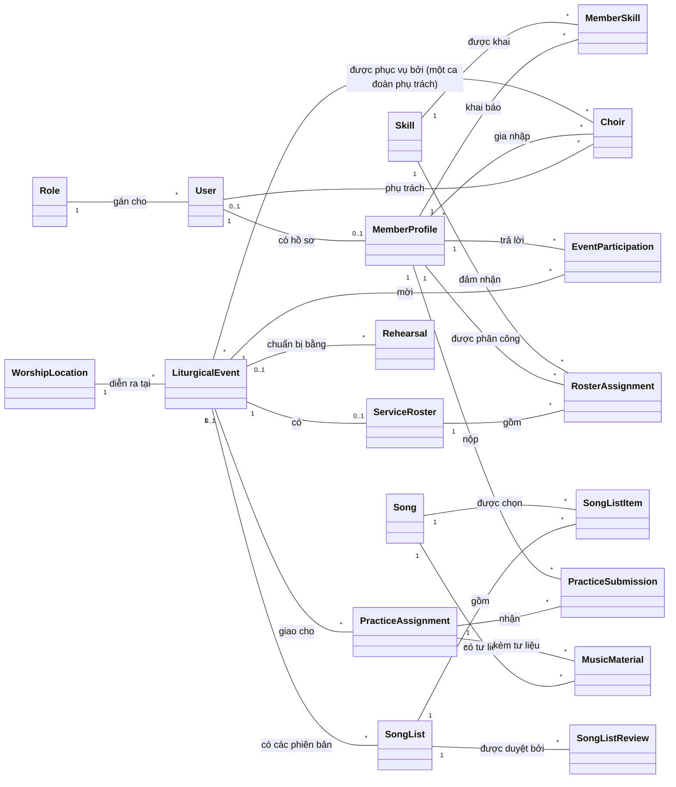
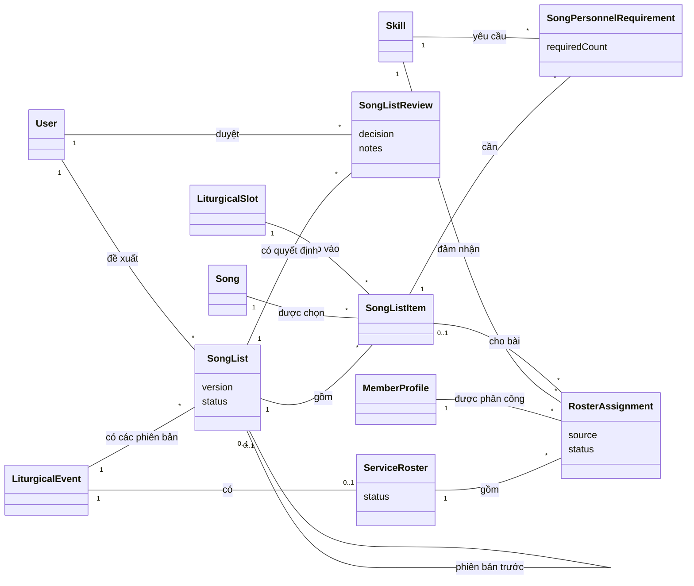

# Hướng dẫn vẽ Conceptual Diagram cho Harmonia

Conceptual diagram (mô hình khái niệm / domain model) trả lời: **hệ thống quản lý những
khái niệm nghiệp vụ nào và chúng liên hệ với nhau ra sao**. Nó không phải sơ đồ cơ sở dữ
liệu: không có kiểu dữ liệu, không có khoá chính, khoá ngoại, không có bảng kỹ thuật.

Nguồn dữ liệu: `doc/harmonia-domain-entity-list.md` (48 entity, mục "Relationships for the ERD").
Sơ đồ nộp báo cáo thì **vẽ tay** (draw.io, Astah, Visual Paradigm hoặc giấy) theo mục 3.
Các khối Mermaid ở mục 4 chỉ là **hình mẫu để nhìn theo** — mở Markdown Preview trong
VS Code hoặc dán vào <https://mermaid.live> để xem hình.

## 1. Khác gì với ERD và class diagram

| | Conceptual diagram | ERD (logical / physical) | Class diagram (design) |
|---|---|---|---|
| Người đọc | Cha xứ, ca trưởng, giảng viên | Dev, DBA | Dev |
| Phần tử | Khái niệm nghiệp vụ | Bảng | Class |
| Thuộc tính | Không, hoặc 2–3 cái tiêu biểu | Đủ, có kiểu, PK/FK | Đủ, có kiểu, method |
| Entity kỹ thuật | Bỏ | Có | Có |
| Bảng trung gian n–n | Vẽ thành quan hệ n–n | Vẽ thành bảng | Vẽ thành class |
| Số ô | 15–25 | 48 | Theo layer |

## 2. Chọn khái niệm nào đưa vào

Từ 50 entity, lọc theo ba luật:

1. **Bỏ entity kỹ thuật** — người dùng nghiệp vụ không gọi tên chúng:
   `RefreshToken`, `PasswordResetToken`, `AuditLog`, `SystemSetting`, `ReportExport`,
   `NotificationRecipient`, `LiturgicalDay` (chỉ là cache của API lịch), `LiturgicalNameTranslation`
   (bản dịch tên lễ của cache đó).
2. **Gộp entity trung gian thành quan hệ n–n** khi nó không mang dữ liệu nghiệp vụ riêng:
   `SongClassification`, `SongVocalRequirement`, `SongInstrumentRequirement`,
   `PracticeAssignmentTarget`, `RehearsalSong`, `PracticeAssignmentMaterial` (thành `PracticeAssignment` n–n
   `MusicMaterial`), `LiturgicalEventChoir` (thành `LiturgicalEvent` n–n `Choir`, kèm ghi chú "một ca đoàn phụ trách").
3. **Giữ entity trung gian** khi người dùng thao tác trực tiếp trên nó hoặc nó có trạng thái:
   `MemberSkill` (được duyệt), `EventParticipation` (được xác nhận), `RosterAssignment`
   (được thay), `SongListItem`, `SongPersonnelRequirement`, `RehearsalAttendance`,
   `MaterialLearningProgress`, `ChoirMembership` (ca trưởng thêm / cho rời ca đoàn, có ngày gia nhập).

Kết quả cho Harmonia:

| Nhóm | Khái niệm giữ lại |
|---|---|
| Người dùng | `User`, `Role`, `MemberProfile`, `Choir`, `ChoirMembership` |
| Kỹ năng | `SkillCategory`, `Skill`, `MemberSkill` |
| Phụng vụ | `LiturgicalEvent`, `LiturgicalSeason`, `MassType`, `CeremonyType`, `EventCategory`, `WorshipLocation`, `MassSchedule` |
| Thư viện nhạc | `Song`, `SongTheme`, `MusicMaterial`, `MaterialLearningProgress` |
| Danh sách bài hát | `SongList`, `SongListItem`, `LiturgicalSlot`, `SongListReview` |
| Phân công | `EventParticipation`, `SongPersonnelRequirement`, `ServiceRoster`, `RosterAssignment` |
| Tập hát | `Rehearsal`, `RehearsalAttendance`, `PracticeAssignment`, `PracticeSubmission`, `PracticeFeedback` |
| Liên lạc | `Notification`, `DirectorNote` |

35 khái niệm là quá nhiều cho một trang. Vẽ **một sơ đồ tổng** khoảng 15 ô (mục 4.1) và
**sơ đồ chi tiết theo nhóm** (mục 4.2) cho những nhóm cần giải thích.

Có ô `Choir` (D7, D8): giáo xứ có nhiều ca đoàn, ca viên gia nhập nhiều ca đoàn qua
`ChoirMembership`, một sự kiện có nhiều ca đoàn phục vụ. Mỗi ca đoàn có **một** ca trưởng do Admin gán, một ca
trưởng phụ trách được nhiều ca đoàn — vẽ `User "0..1" -- "*" Choir : phụ trách`. Sự kiện nhiều ca đoàn có
**một ca đoàn phụ trách** (cha xứ chọn) lập danh sách bài, mời và phân công; các ca đoàn khác chỉ xem.
`MassSchedule` chỉ là khuôn
mẫu giờ lễ để sinh sự kiện nháp, không nối tới `LiturgicalEvent`. Không có ô `Instrumentalist` — nhạc công
là `MemberProfile` có `MemberSkill` thuộc `SkillCategory` nhạc cụ.

## 3. Cách vẽ tay

### Hình cần dùng

| Phần tử | Hình vẽ | Ghi chú |
|---|---|---|
| Khái niệm | Hình chữ nhật góc vuông, tên ở giữa, in đậm | Tên đúng như trong code, số ít |
| Thuộc tính (tuỳ chọn) | Kẻ một vạch ngang dưới tên, liệt kê 2–3 thuộc tính | Chỉ tên, không ghi kiểu, không ghi `id` |
| Quan hệ | Đường thẳng liền nối hai ô, **không có mũi tên** | |
| Bội số | Số ghi ở **hai đầu** đường nối: `1`, `0..1`, `*`, `1..*` | Đầu nào cũng phải có |
| Tên quan hệ | Động từ ghi giữa đường nối, kèm tam giác nhỏ ▸ chỉ chiều đọc | "có", "thuộc", "duyệt" |
| Quan hệ với chính nó | Đường vòng ra rồi quay về cùng một ô | `SongList` – phiên bản trước |
| Ghi chú | Hình chữ nhật gập góc, nối nét đứt | Cho quyết định mô hình (D1–D7) |

Không vẽ: hình thoi quan hệ kiểu Chen, ký hiệu PK/FK, mũi tên kế thừa, method.
Nếu giảng viên yêu cầu ký hiệu **crow's foot** thì thay bội số bằng chân quạ ở đầu đường
nối: `|` = một, `o` = không, chân quạ = nhiều. Nội dung giữ nguyên.

### Đọc bội số từ tài liệu

Mục "Relationships for the ERD" ghi dạng `A 1 — n B`. Đổi sang bội số UML:

| Trong tài liệu | Đầu phía A | Đầu phía B | Đọc là |
|---|---|---|---|
| `A 1 — n B` | `1` | `*` | Một A có nhiều B, mỗi B thuộc đúng một A |
| `A 1 — 1 B` | `1` | `0..1` | Một A có tối đa một B |
| `B n — 0..1 A` (FK có dấu `?`) | `0..1` | `*` | B có thể không gắn với A nào |
| n–n đã gộp entity trung gian | `*` | `*` | Nhiều A liên hệ nhiều B |

Kiểm tra mỗi đường nối bằng cách đọc thành hai câu, một câu cho mỗi chiều. Câu nào nghe
sai nghiệp vụ thì bội số sai.

### Thứ tự vẽ

1. Lập **danh sách khái niệm** theo mục 2, đánh dấu cái nào vào sơ đồ tổng.
2. Lập **bảng quan hệ**: `Khái niệm A | Bội số A | Động từ | Bội số B | Khái niệm B`.
   Mỗi dòng một đường nối. Bảng đúng thì sơ đồ đúng.
3. Đặt bốn hub vào **giữa trang**, cách đều nhau: `LiturgicalEvent`, `MemberProfile`,
   `Song`, `Skill`.
4. Đặt các khái niệm nối hai hub vào **giữa** hai hub đó: `MemberSkill` giữa `MemberProfile`
   và `Skill`; `SongList` giữa `LiturgicalEvent` và `Song`; `EventParticipation` giữa
   `LiturgicalEvent` và `MemberProfile`.
5. Đặt các khái niệm còn lại quanh hub mà nó phụ thuộc.
6. Đặt danh mục (`MassType`, `SongTheme`, `SkillCategory`...) ở **rìa ngoài** — chúng chỉ
   có một đường nối.
7. Vẽ đường nối theo bảng ở bước 2, đánh dấu dòng đã vẽ.
8. Ghi bội số hai đầu, rồi ghi tên quan hệ.
9. Thêm ghi chú cho những điểm người đọc hay hỏi: mỗi ca đoàn một ca trưởng, sự kiện nhiều ca đoàn có một
   **ca đoàn phụ trách** (D8), không có role nhạc công, `SongList` mỗi phiên bản một dòng.

### Bố cục

- Đường nối không cắt nhau. Cắt thì dời ô, hoặc tách sang sơ đồ chi tiết.
- Các ô cùng kích thước, căn theo lưới.
- Mỗi ô không quá 5–6 đường nối trên sơ đồ tổng; hub quá đông thì đẩy bớt quan hệ sang
  sơ đồ chi tiết.
- Có thể tô màu nền nhạt theo nhóm ở mục 2 và kèm chú giải màu.
- Sơ đồ tổng vừa một trang A4 ngang. Tiêu đề: `Conceptual Diagram – Harmonia`.

## 4. Sơ đồ mẫu

### 4.1 Sơ đồ tổng

`MemberProfile — Choir` vẽ gọn thành n–n ở sơ đồ tổng; ở sơ đồ chi tiết thì tách thành ô
`ChoirMembership` (thuộc tính `joinedDate`, `isActive`). Ba quan hệ tuỳ chọn
`Choir "0..1" -- "*" SongList / Rehearsal / PracticeAssignment` chỉ vẽ ở sơ đồ chi tiết để
`Choir` không quá đông đường nối.

### 4.2 Sơ đồ chi tiết — danh sách bài hát và phân công

Các nhóm còn lại (kỹ năng, ca đoàn, phụng vụ, thư viện nhạc, tập hát, liên lạc) vẽ theo cùng cách
— nhóm phụng vụ có thêm `MassType "1" -- "*" MassSchedule` và `WorshipLocation "1" -- "*" MassSchedule`, lấy quan hệ
từ mục "Relationships for the ERD" của `doc/harmonia-domain-entity-list.md`.

## 5. Checklist trước khi nộp sơ đồ

- [ ] Mọi tên ô có trong `doc/harmonia-domain-entity-list.md`, viết đúng, số ít.
- [ ] Không có ô `Instrumentalist`, `Event`, `Season`, `SheetMusic`, `Assignment`.
- [ ] Không có entity kỹ thuật (token, log, setting).
- [ ] Không có kiểu dữ liệu, `id`, khoá ngoại.
- [ ] Mọi đường nối có bội số ở **cả hai đầu** và có tên quan hệ.
- [ ] Mỗi đường nối đọc được thành hai câu đúng nghiệp vụ.
- [ ] Bốn hub nằm giữa, danh mục nằm ngoài rìa, không đường nào cắt nhau.
- [ ] Sơ đồ tổng không quá 20 ô; phần còn lại nằm ở sơ đồ chi tiết.
- [ ] Đổi entity hoặc quan hệ trong `harmonia-domain-entity-list.md` thì sửa sơ đồ trong cùng PR.

## Lịch sử sửa

**2026-10-26** — đối chiếu `main@718696c` (D8 và đợt backlog Web), so với bản trước:

- **Sửa** đoạn giới thiệu ô `Choir` ở mục 2: bỏ "một `ChoirDirector` quản lý mọi ca đoàn — không vẽ quan hệ ca trưởng";
  thay bằng mỗi ca đoàn một ca trưởng, một ca trưởng nhiều ca đoàn, sự kiện nhiều ca đoàn có ca đoàn phụ trách (D8).
- **Sửa** bước 9 mục 3: ghi chú "một ca trưởng chung (D7)" → "mỗi ca đoàn một ca trưởng, có ca đoàn phụ trách (D8)".
- **Sửa** mục 2: "48 entity" → 50; luật 1 thêm `LiturgicalNameTranslation`; luật 2 thêm `PracticeAssignmentMaterial`
  và ghi chú "một ca đoàn phụ trách" cho `LiturgicalEventChoir`.
- **Thêm** vào sơ đồ tổng 4.1: `User "0..1" -- "*" Choir : phụ trách` và
  `PracticeAssignment "*" -- "*" MusicMaterial : kèm tư liệu`; nhãn `LiturgicalEvent -- Choir` thêm "(một ca đoàn phụ trách)".
- **Xoá** không có. Số khái niệm giữ lại vẫn 35 (hai entity mới đều bị lọc theo luật 1 và 2).
