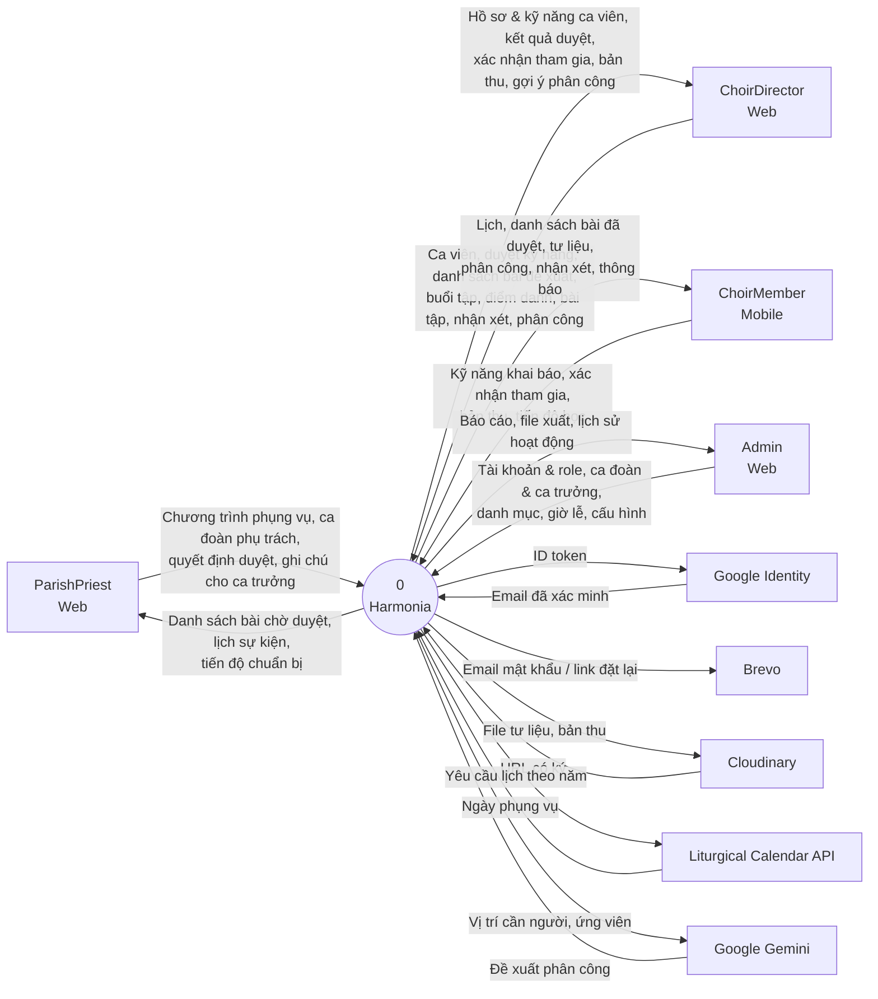

# Hướng dẫn vẽ Context Diagram cho Harmonia

Context diagram (sơ đồ ngữ cảnh, DFD mức 0) trả lời: **hệ thống trao đổi dữ liệu gì với ai
ở bên ngoài nó**. Cả Harmonia là **một** hình duy nhất ở giữa; xung quanh là các tác nhân
(người dùng và hệ thống ngoài); mũi tên là luồng dữ liệu đi vào / đi ra. Không vẽ gì bên trong hệ thống.

Nguồn dữ liệu: bảng 4 actor trong `CLAUDE.md`, `doc/harmonia-feature-list.md`, và
`src/Harmonia.Infrastructure/ExternalServices/` (mỗi class ở đó bọc một hệ thống ngoài).
Sơ đồ nộp báo cáo thì **vẽ tay** (draw.io, Visual Paradigm, Lucidchart) theo mục 3.
Khối Mermaid ở mục 4 chỉ là **hình mẫu để nhìn theo**.

## 1. Khác gì với use case diagram

| | Context diagram | Use case diagram |
|---|---|---|
| Câu hỏi | Dữ liệu gì đi vào / ra hệ thống | Ai làm được việc gì |
| Hệ thống | Một hình tròn, không mở ra | Khung chứa nhiều use case |
| Đường nối | Mũi tên có tên luồng dữ liệu (danh từ) | Đường thẳng không tên |
| Tên trên đường | Danh từ: "Danh sách bài đề xuất" | Use case là động từ: "Đề xuất danh sách bài" |
| Hệ thống ngoài | Bắt buộc vẽ | Thường bỏ hoặc vẽ actor phụ |

## 2. Tác nhân ngoài

### 4 actor người dùng

| Tác nhân | Nền tảng | Ghi chú |
|---|---|---|
| `ParishPriest` | Web | Cha xứ / ban phụng vụ |
| `ChoirDirector` | Web | Ca trưởng — KHÔNG ghi "ChoirLeader" |
| `ChoirMember` | Mobile | Ca viên, kể cả nhạc công — không có ô "Instrumentalist" |
| `Admin` | Web | Quản trị |

### 5 hệ thống ngoài

| Tác nhân | Class bọc nó | Dùng để |
|---|---|---|
| Google Identity | `GoogleTokenValidator` | Xác minh ID token khi đăng nhập Google |
| Brevo (email) | `BrevoEmailSender` | Gửi mật khẩu đầu tiên, link đặt lại mật khẩu |
| Cloudinary (lưu file) | `CloudinaryFileStorageService` | Lưu tư liệu bài hát, bản thu nộp; cấp URL có ký |
| Liturgical Calendar API (`litcal.johnromanodorazio.com`) | `LiturgicalCalendarApiClient` | Lấy lịch phụng vụ Công giáo theo năm |
| Google Gemini | `GeminiRosterSuggestionGenerator` | Gợi ý phân công phục vụ |

### Không vẽ thành tác nhân

- **SQL Server / Azure SQL** — kho dữ liệu của chính Harmonia, nằm bên trong hệ thống.
- **Azure SignalR Service** — kênh đẩy thông báo của chính Harmonia; thông báo vẽ thành luồng tới từng actor.
- **Web app / Mobile app** — là giao diện của hệ thống, không phải bên ngoài. Ghi nền tảng dưới tên actor nếu cần.
- **Hộp thư của người dùng** — Brevo gửi tiếp tới người dùng, nằm ngoài ranh giới sơ đồ.

## 3. Cách vẽ tay

### Hình cần dùng

Chọn **một** bộ ký hiệu và giữ nguyên trong cả báo cáo. Khuyên dùng Yourdon–DeMarco:

| Phần tử | Yourdon–DeMarco | Gane–Sarson |
|---|---|---|
| Hệ thống | Hình tròn, ghi "0" và "Harmonia" | Chữ nhật bo góc, ô trên ghi "0" |
| Tác nhân ngoài | Chữ nhật | Chữ nhật, đổ bóng / viền đôi |
| Luồng dữ liệu | Mũi tên một chiều có tên | Như bên trái |

Không vẽ: kho dữ liệu (data store), tiến trình con, mũi tên giữa hai tác nhân ngoài,
mũi tên không tên, mũi tên hai đầu.

### Luồng dữ liệu

Tên luồng là **danh từ chỉ dữ liệu**, không phải hành động. Mỗi chiều một mũi tên riêng.
Nhiều luồng cùng chiều với một tác nhân thì gộp thành 1 mũi tên, liệt kê tên cách nhau dấu phẩy,
hoặc tách 2–3 mũi tên nếu đủ chỗ.

| Tác nhân | Vào Harmonia | Ra từ Harmonia |
|---|---|---|
| Mọi actor | Thông tin đăng nhập, Google ID token | Token truy cập, thông báo |
| `ParishPriest` | Chương trình phụng vụ (sự kiện), ca đoàn phục vụ và ca đoàn phụ trách, quyết định duyệt danh sách bài, ghi chú cho ca trưởng | Danh sách bài chờ duyệt, lịch sự kiện, tiến độ chuẩn bị sự kiện |
| `ChoirDirector` | Ca viên của ca đoàn, quyết định duyệt kỹ năng, danh sách bài đề xuất, buổi tập, điểm danh, bài tập, nhận xét bản thu, phân công phục vụ | Hồ sơ và kỹ năng ca viên, kết quả duyệt danh sách bài, xác nhận tham gia, bản thu nộp, gợi ý phân công, ghi chú của cha xứ |
| `ChoirMember` | Kỹ năng khai báo, xác nhận tham gia, bản thu tập hát, tiến độ học tư liệu | Lịch sự kiện và buổi tập, danh sách bài đã duyệt, tư liệu bài hát, phân công phục vụ, nhận xét |
| `Admin` | Tài khoản và role, ca đoàn và ca trưởng, danh mục, giờ lễ cố định, cấu hình hệ thống, bản dịch tên lễ | Báo cáo, file xuất (CSV/XLSX/PDF), lịch sử hoạt động |
| Google Identity | Thông tin email đã xác minh | ID token cần xác minh |
| Brevo | — | Email (mật khẩu đầu tiên, link đặt lại mật khẩu) |
| Cloudinary | URL file có ký | File tư liệu, file bản thu |
| Liturgical Calendar API | Ngày phụng vụ (tên lễ, bậc lễ, mùa, màu áo lễ) | Yêu cầu lịch theo năm |
| Gemini | Đề xuất phân công | Vị trí cần người, ca viên ứng viên và kỹ năng |

Luồng "Thông tin đăng nhập / Token truy cập / thông báo" chung cho cả 4 actor: hoặc vẽ ở từng actor,
hoặc ghi chú một lần "áp dụng cho mọi actor" để đỡ rối.

### Thứ tự vẽ

1. Đặt hình tròn **Harmonia** ở giữa trang.
2. Đặt **4 actor người dùng** bên trái (hoặc trên + trái), **5 hệ thống ngoài** bên phải (hoặc dưới + phải).
3. Vẽ mũi tên theo bảng luồng dữ liệu, từng tác nhân một: chiều vào trước, chiều ra sau.
4. Ghi tên lên từng mũi tên, đánh dấu dòng đã vẽ trong bảng.
5. Thêm ghi chú: ca viên dùng Mobile, các actor khác dùng Web; nhạc công là `ChoirMember`.

### Bố cục

- Mũi tên không cắt nhau. Cặp vào / ra của một tác nhân đi song song.
- Tác nhân ngoài cùng loại cùng kích thước, căn thẳng hàng.
- Chữ trên mũi tên nằm ngang, đặt sát mũi tên của nó.
- Có thể tô hai màu nền: người dùng một màu, hệ thống ngoài một màu, kèm chú giải.

## 4. Sơ đồ mẫu

Mermaid không đặt được tác nhân hai bên hình tròn như vẽ tay — chỉ dùng để kiểm đủ luồng.

## 5. Checklist trước khi nộp sơ đồ

- [ ] Chỉ có **một** tiến trình (Harmonia), đánh số 0.
- [ ] Đủ 4 actor + 5 hệ thống ngoài; không có ô database, SignalR, "Instrumentalist", "ChoirLeader".
- [ ] Mọi mũi tên một chiều, có tên là danh từ chỉ dữ liệu.
- [ ] Mỗi tác nhân có ít nhất một luồng; actor người dùng có cả chiều vào lẫn ra.
- [ ] Không có mũi tên nối trực tiếp hai tác nhân ngoài.
- [ ] Cùng bộ ký hiệu (Yourdon–DeMarco hoặc Gane–Sarson) với DFD khác trong báo cáo.
- [ ] Thêm / bỏ hệ thống ngoài (class mới trong `ExternalServices/`) thì sửa sơ đồ trong cùng PR.

## Lịch sử sửa

**2026-10-27** — tạo mới, đối chiếu `main@c8ba80f`.
