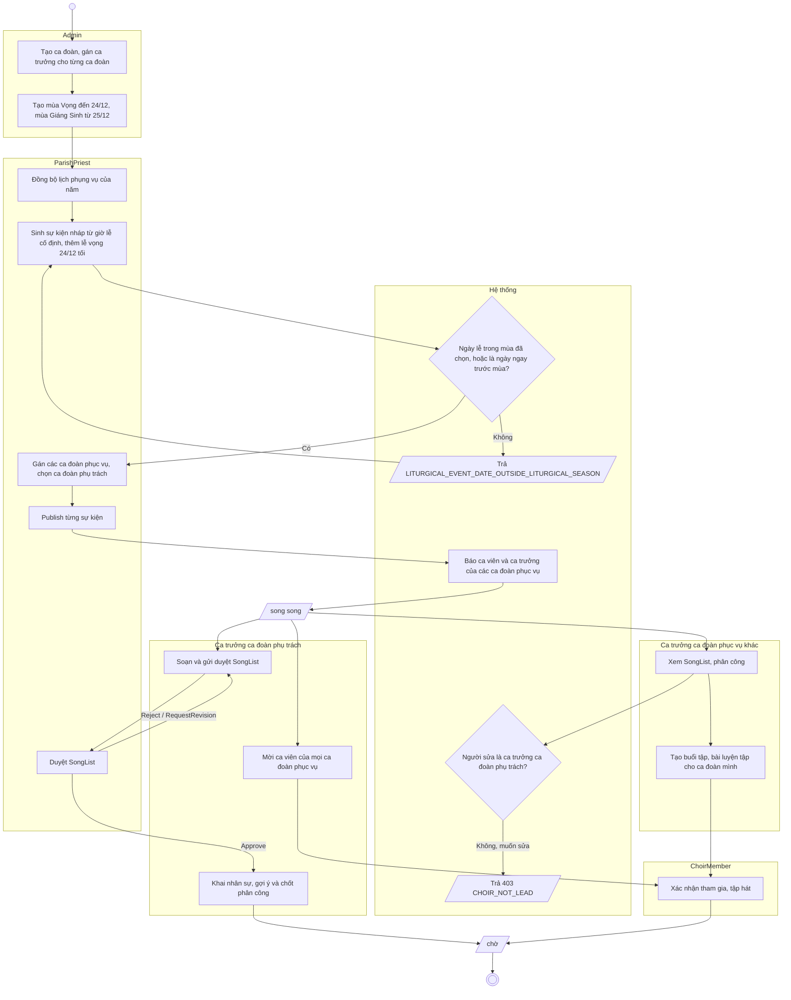

# Ghi chú sửa sơ đồ (đối chiếu code `main@718696c`, 26/10/2026)

Sơ đồ đang lệch code ở hai mốc: **D7 / D8 nhiều ca đoàn** (17–25/10) và **đợt backlog Web** (25/10). Mỗi mục ghi file
nguồn, việc cần sửa và lý do. Tick khi xong.

**Trạng thái 26/10:** đã sửa xong các file chữ / mermaid (ERD `.mmd`, 4 guide, diagram plan). **Còn lại** (ô chưa tick ở
mục 3): vẽ lại trong `../Class Diagram.drawio`, và chốt mã UC cho quản lý bản dịch tên lễ.

## 1. ERD — `../doc/harmonia-erd.mmd` + `doc/harmonia-erd-guide.md`

`harmonia-erd.mmd` (sửa lần cuối 20/10) chưa có bảng nào của D7. Phải thêm 6 bảng và 2 cột:

- [x] `Choir` (nhóm A) — `Id`, `Name`, `Description?`, `IsActive`, **`DirectorId?` → `User`**, cột audit.
      Quan hệ: `User |o--o{ Choir : "directs"` (một ca đoàn một ca trưởng, một ca trưởng nhiều ca đoàn — D8).
- [x] `ChoirMembership` (nhóm A) — `MemberId` → `MemberProfile`, `ChoirId` → `Choir`, `JoinedDate`, `IsActive`.
- [x] `LiturgicalEventChoir` (nhóm C) — `EventId`, `ChoirId`, **`IsLead`** (ca đoàn phụ trách, cha xứ chọn, tối đa một).
- [x] `MassSchedule` (nhóm C) — `DayOfWeek`, `Time`, `MassTypeId`, `LocationId`, `Title?`, `IsActive`, audit.
- [x] **`PracticeAssignmentMaterial`** (nhóm G, mới 25/10) — `PracticeAssignmentId` (cascade), `MaterialId` (restrict),
      `DisplayOrder`, unique `(PracticeAssignmentId, MaterialId)`.
      Quan hệ: `PracticeAssignment ||--o{ PracticeAssignmentMaterial`, `MusicMaterial ||--o{ PracticeAssignmentMaterial`.
      Giữ đường cũ `MusicMaterial ||--o{ PracticeAssignment` (cột `MaterialId` vẫn còn = tư liệu đầu tiên), ghi chú "giữ cho client cũ".
- [x] **`LiturgicalNameTranslation`** (nhóm C, mới 25/10) — `Kind` (enum `LiturgicalNameKind`), `EnglishName`, `VietnameseName`,
      audit, unique `(Kind, EnglishName)`. **Không FK**: khớp theo chữ với `LiturgicalDay` → đường nét đứt "khớp theo tên"
      như cặp `LiturgicalDay` ↔ `LiturgicalEvent`.
- [x] Cột `ChoirId?` trên `SongList`, `Rehearsal`, `PracticeAssignment` → `Choir` (D7).
- [x] Guide `harmonia-erd-guide.md`: bảng nhóm ở mục 1 — C: 9 → 10, G: 7 → 8; "48 bảng" → **50** (dòng 5, 21, 98 và checklist dòng 362).

## 2. Conceptual — `doc/harmonia-conceptual-diagram-guide.md`

Sai theo D8 (đoạn mục 2 và bước 9 mục 3 vẫn viết "một ca trưởng chung cho mọi ca đoàn"):

- [x] Sửa đoạn "Có ô `Choir` (D7)…": mỗi `Choir` có **một** ca trưởng, một ca trưởng phụ trách nhiều ca đoàn.
      Vẽ quan hệ `User "0..1" -- "*" Choir : phụ trách` (bỏ câu "không vẽ quan hệ ca trưởng của").
- [x] Bước 9 mục 3: đổi ghi chú "nhiều ca đoàn nhưng một ca trưởng chung (D7)" thành "mỗi ca đoàn một ca trưởng; sự kiện
      nhiều ca đoàn có một **ca đoàn phụ trách** (D8)".
- [x] Sơ đồ tổng 4.1: quan hệ `LiturgicalEvent "*" -- "*" Choir : được phục vụ bởi` thêm ghi chú "một ca đoàn phụ trách".
- [x] Sơ đồ tổng 4.1: thêm `PracticeAssignment "*" -- "*" MusicMaterial : kèm tư liệu` (bảng trung gian
      `PracticeAssignmentMaterial` gộp thành n–n theo luật 2).
- [x] Mục 2 luật 1 (entity kỹ thuật bị bỏ): thêm `LiturgicalNameTranslation`. Luật 2 (gộp n–n): thêm `PracticeAssignmentMaterial`.

## 3. Class — `../Class Diagram.drawio` + `doc/harmonia-diagram-plan.md`

**D8 (ảnh hưởng nhiều tab):**

- [ ] F13 (đã vẽ): `Choir` thêm `+Guid? DirectorId`; `LiturgicalEventChoir` thêm `+bool IsLead`;
      `UpdateEventChoirsRequest` có `leadChoirId`; quan hệ `User "0..1" -- "*" Choir`.
- [ ] Class dùng chung (vẽ đủ ở tab F13 — plan đã chốt 3.13; các tab khác chỉ vẽ ô tên): `IChoirScopeService` / `ChoirScopeService` —
      `GetDirectedChoirIdsAsync`, `CanManageChoirAsync`, `CheckChoirForNewRecordAsync`, `CanViewEventAsync`,
      `CanLeadEventAsync`, `CheckCanLeadEventAsync`, `GetLeadChoirIdAsync`, `GetEventMemberIdsAsync`,
      `GetChoirMemberIdsAsync`, `GetMemberChoirIdsAsync`.
- [ ] Thêm ô `IChoirScopeService` và mũi tên phụ thuộc ở các service đang dùng nó:
      F4 `LiturgicalEventService`, `UpcomingScheduleService` · F6 `SongListService` · F7 `RehearsalService`,
      `RehearsalSongService`, `EventParticipationService` · F8 `RosterService`, `SongPersonnelRequirementService` ·
      F9 `PracticeAssignmentService`, `PracticeSubmissionService` · F10 `RehearsalAttendanceService`,
      `EventPreparationService` · F12 `ReportService`.

**Đợt 25/10:**

- [ ] **3.4 F4:** thêm `LiturgicalNameTranslationsController`, `ILiturgicalNameTranslationService` /
      `LiturgicalNameTranslationService`, `ILiturgicalNameTranslationRepository`, `LiturgicalNameTranslation`, enum
      `LiturgicalNameKind`, lớp tĩnh `LiturgicalNamePatterns`. `LiturgicalDayService` phụ thuộc thêm
      `ILiturgicalNameTranslationRepository`; `IUserRepository` thêm `GetActiveUserIdsOfEventChoirsAsync`.
- [ ] **3.5 F5:** `ISongRepository` thêm `IsInUseAsync`, `GetStatsAsync`; `SongDto` thêm 4 trường; record `SongStats`.
      `IMusicMaterialService` thêm `ReplaceFileAsync`; `MusicMaterialsController` thêm `ReplaceFileAsync`.
- [ ] **3.9 F9:** thêm `PracticeAssignmentMaterial`; `PracticeAssignment "1" *-- "*" PracticeAssignmentMaterial`;
      `PracticeAssignmentService` phụ thuộc `IMusicMaterialRepository` (đã có, giờ dùng `ListAsync`).
- [ ] **3.12 F12:** `IReportService` thêm `GetActivityTrendAsync`; `IReportExportService` thêm `GetColumns`;
      `ReportsController` thêm `GetActivityTrendAsync`, `GetColumns`; DTO `ActivityTrendDto`, `ReportColumnDto`;
      enum `ReportPeriod`.
- [ ] **3.14 F14:** `ISystemSettingService.GetPublicAsync(bool isSignedIn, …)`; `SystemSettingDto` thêm `DisplayName`,
      `Group`, `Order`.
- [x] Ghi các class trên vào danh sách **Class** của từng mục trong `harmonia-diagram-plan.md`.

**Sequence** (cùng file plan):

- [x] UC-12 (F4): bước publish / cancel — lấy người nhận bằng `GetActiveUserIdsOfEventChoirsAsync`; `alt` sự kiện chưa có
      ca đoàn → `GetActiveUserIdsByRolesAsync` (cả giáo xứ).
- [x] UC-21 (F5): xoá bài — `alt` `IsInUseAsync` = true → `409 SONG_IN_USE`. Thêm luồng thay file (upload mới → lưu →
      xoá file cũ; lưu lỗi thì xoá file mới).
- [x] UC-28 (F9): tạo bài tập — kiểm danh sách tư liệu bằng một `ListAsync`, tạo các dòng `PracticeAssignmentMaterial`.
- [x] UC-34 (F12): thêm `activity-trend` (đọc mọi trang ca viên → bài tập → chia kỳ).
- [ ] Hỏi: quản lý bản dịch tên lễ gộp vào UC-32 hay thêm UC mới — cần chốt trước khi vẽ sequence.

## 4. Activity — `doc/harmonia-activity-diagram-guide.md`

- [x] 4.1 "Chuẩn bị một sự kiện": thêm bước cha xứ **gán ca đoàn phục vụ + chọn ca đoàn phụ trách** giữa "Tạo" và
      "Publish"; publish báo cho ca đoàn phục vụ; lane ChoirDirector đổi thành "ca trưởng ca đoàn phụ trách".
- [x] 4.4 "Nộp và chấm bài tập": ô `A1` đổi thành "Tạo PracticeAssignment: ca đoàn, bài, tư liệu (một hoặc nhiều),
      đối tượng, hạn nộp".
- [x] **Thêm 4.6 "Lễ Giáng Sinh nhiều ca đoàn"** — chưa có. Thêm dòng vào bảng mục 1:
      `| Lễ Giáng Sinh nhiều ca đoàn | UC-32, UC-12, UC-12E, UC-39, UC-22, UC-23, UC-20 | Năm actor, mùa lệch một ngày cho lễ vọng, ca đoàn phụ trách |`.
      Bản nháp:

Ghi chú dưới sơ đồ: lễ vọng 24/12 tối được gán mùa Giáng Sinh dù mùa bắt đầu 25/12 (cho phép sớm một ngày, `c93eac6`);
lễ sáng 24/12 thuộc mùa Vọng. Sự kiện chưa gắn ca đoàn thì bỏ P3, ca trưởng nào cũng làm được (luồng 4.1).

## 5. State — `doc/harmonia-state-diagram-guide.md`

- [x] Bảng mục 1: `EventParticipation` đổi từ "Chưa" thành **"Có"** — service đã có từ `cea8553`. Thêm sơ đồ 5.x:
      `[*] → Invited : ca trưởng mời (mỗi ca viên một lần, sự kiện Published, chưa bắt đầu)` ·
      `Invited → Confirmed / Declined / Unsure : ca viên trả lời một lần [sự kiện chưa bắt đầu]`.
      Từ chối: `EVENT_PARTICIPATION_ALREADY_REQUESTED`, `EVENT_PARTICIPATION_ALREADY_RESPONDED`, `EVENT_PARTICIPATION_CLOSED`.
- [x] 5.1 `LiturgicalEvent`: hai nhãn "báo ChoirDirector + ChoirMember" đổi thành "báo ca đoàn phục vụ (chưa gán ca đoàn:
      cả giáo xứ)". Bảng từ chối thêm các guard của publish: `LITURGICAL_EVENT_ALREADY_PASSED`,
      `LITURGICAL_EVENT_TYPE_REQUIRED`, `LITURGICAL_EVENT_SEASON_REQUIRED`, `LOOKUP_INACTIVE`, `LITURGICAL_EVENT_SLOT_TAKEN`.
- [x] 5.6 vòng đời nhỏ: thêm `Song (IsActive)` — `Active → Inactive : xoá [chưa dùng ở SongList, RehearsalSong,
      PracticeAssignment]`, từ chối `SONG_IN_USE`; không quay lại. Thêm `MusicMaterial (IsActive)` —
      `Active → Active : thay file`, `Active → Inactive : xoá`.
- [x] Mục 6 (quan hệ giữa các sơ đồ): `SongList` / `ServiceRoster` của sự kiện nhiều ca đoàn chỉ ca đoàn phụ trách được đổi.

## 6. Không cần sửa

- Use case diagram: các thay đổi nằm trong UC sẵn có, trừ quản lý bản dịch (xem câu hỏi ở mục 3).
- State `SongList`, `ServiceRoster`, `MemberSkill`, `PracticeSubmission`: luật chuyển không đổi.

## Lịch sử sửa

**2026-10-26** — các file đã sửa theo ghi chú này (mỗi file có mục "Lịch sử sửa" riêng ở cuối, ghi chi tiết thêm /
sửa / xoá):

| File | Thêm | Sửa | Xoá |
|---|---|---|---|
| `../doc/harmonia-erd.mmd` | 6 bảng (`Choir`, `ChoirMembership`, `LiturgicalEventChoir`, `MassSchedule`, `PracticeAssignmentMaterial`, `LiturgicalNameTranslation`) và 13 quan hệ | Đầu file 44 → 50 bảng, D1–D8; nhãn `MusicMaterial → PracticeAssignment` | Không |
| `doc/harmonia-erd-guide.md` | 2 bảng vào nhóm C, G; 2 dòng trường hợp đặc biệt; 2 unique | 48 → 50 bảng, 22 → 24 enum | Không |
| `doc/harmonia-conceptual-diagram-guide.md` | 2 quan hệ ở sơ đồ tổng | Đoạn ô `Choir` và bước 9 theo D8; luật lọc 1, 2; 48 → 50 | Câu "một `ChoirDirector` quản lý mọi ca đoàn — không vẽ quan hệ ca trưởng" |
| `doc/harmonia-diagram-plan.md` | Quy ước `IChoirScopeService`; class mới ở 3.4, 3.5, 3.9, 3.12, 3.13, 3.14; dòng UC bản dịch (chưa mã) | Ghi chú sequence UC-12, 21, 28, 34, 37, 38, 39 | Không |
| `doc/harmonia-activity-diagram-guide.md` | Mục 4.6 Lễ Giáng Sinh nhiều ca đoàn + dòng ở bảng mục 1 | 4.1 thêm bước gán ca đoàn, đổi tên lane; 4.4 ô `A1` | Không |
| `doc/harmonia-state-diagram-guide.md` | 5.6 `EventParticipation`; `Song`, `MusicMaterial` ở vòng đời nhỏ | 5.1 guard publish và nhãn thông báo; mục 6; đánh số 5.6 → 5.7 | Dòng `EventParticipation` "Chưa" ở bảng mục 1 |
| `../Class Diagram.drawio` | — | **Chưa sửa** — mermaid nhúng trong draw.io, sửa tay theo mục 3 | — |
