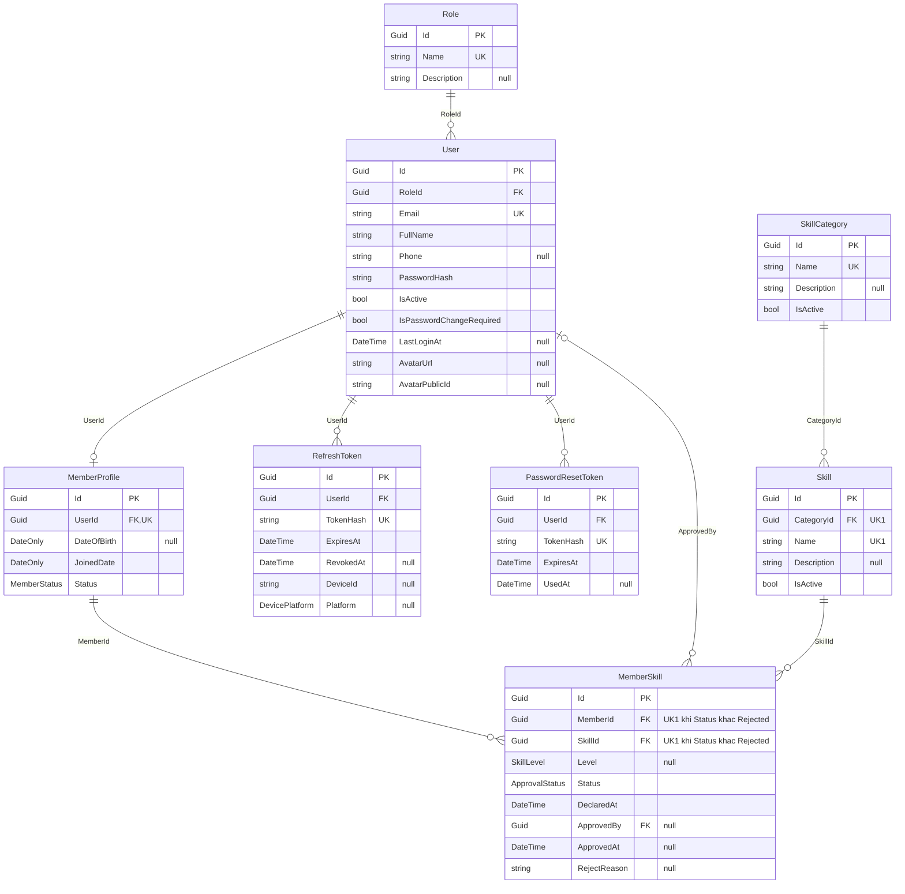
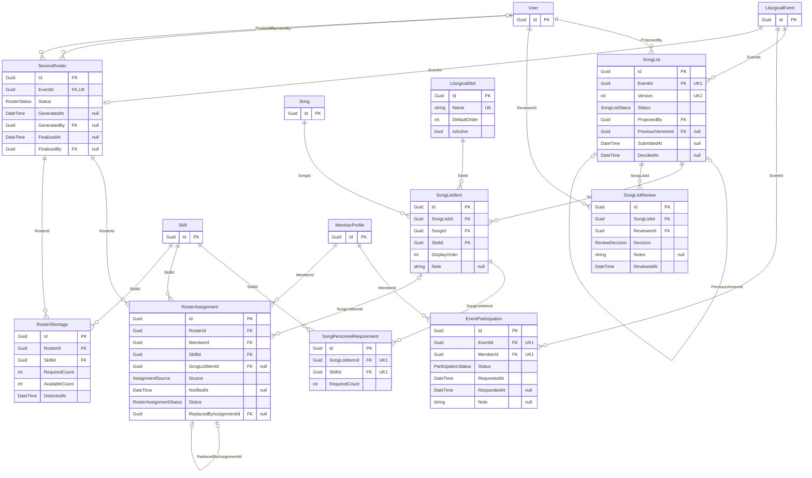

# Hướng dẫn vẽ ERD cho Harmonia

ERD (Entity Relationship Diagram) trả lời: **cơ sở dữ liệu có những bảng nào, mỗi bảng có
cột gì, bảng nào tham chiếu bảng nào**. Khác với conceptual diagram
(`harmonia-conceptual-diagram-guide.md`), ERD vẽ **đủ 44 entity**, kể cả entity kỹ thuật và
bảng trung gian, có thuộc tính, khoá chính, khoá ngoại.

Nguồn dữ liệu, theo thứ tự ưu tiên khi hai bên lệch nhau:

1. `src/Harmonia.Infrastructure/Data/Configurations/<Entity>Configuration.cs` — thứ thật sự
   nằm trong database (unique index, cột bắt buộc, hành vi xoá).
2. `src/Harmonia.Domain/Entities/<Entity>.cs` — danh sách property.
3. `doc/harmonia-domain-entity-list.md` — mô tả, kiểu, mục "Relationships for the ERD".

Sơ đồ nộp báo cáo thì **vẽ tay** (draw.io, Astah, Visual Paradigm hoặc giấy) theo mục 3.
Các khối Mermaid ở mục 4 chỉ là **hình mẫu để nhìn theo** — mở Markdown Preview trong
VS Code hoặc dán vào <https://mermaid.live> để xem hình.

## 1. Chia sơ đồ

44 bảng không vừa một trang. Vẽ **một sơ đồ tổng** chỉ có tên bảng và đường nối, rồi
**chín sơ đồ chi tiết** có đủ cột, theo đúng chín nhóm của `harmonia-domain-entity-list.md`:

| Nhóm | Bảng | Số bảng |
|---|---|---|
| A. Identity & Access | `User`, `Role`, `MemberProfile`, `RefreshToken`, `PasswordResetToken` | 5 |
| B. Skills | `SkillCategory`, `Skill`, `MemberSkill` | 3 |
| C. Liturgical calendar | `LiturgicalDay`, `LiturgicalEvent`, `LiturgicalSeason`, `MassType`, `CeremonyType`, `EventCategory`, `WorshipLocation` | 7 |
| D. Music library | `Song`, `SongTheme`, `SongClassification`, `SongVocalRequirement`, `SongInstrumentRequirement`, `MusicMaterial`, `MaterialLearningProgress` | 7 |
| E. Song list & approval | `SongList`, `SongListItem`, `LiturgicalSlot`, `SongListReview` | 4 |
| F. Participation & roster | `EventParticipation`, `SongPersonnelRequirement`, `ServiceRoster`, `RosterAssignment`, `RosterShortage` | 5 |
| G. Rehearsal & practice | `Rehearsal`, `RehearsalAttendance`, `RehearsalSong`, `PracticeAssignment`, `PracticeAssignmentTarget`, `PracticeSubmission`, `PracticeFeedback` | 7 |
| H. Communication | `Notification`, `NotificationRecipient`, `DirectorNote` | 3 |
| I. System | `SystemSetting`, `AuditLog`, `ReportExport` | 3 |

Bảng thuộc nhóm khác mà sơ đồ chi tiết cần tham chiếu (thường là `User`, `MemberProfile`,
`Skill`, `LiturgicalEvent`, `Song`) thì vẽ thành **ô chỉ có tên và khoá chính**, tô nền xám
để người đọc biết nó được mô tả ở sơ đồ khác.

## 2. Lấy thông tin cho một bảng

1. **Cột**: mở `Domain/Entities/<Entity>.cs`, lấy mọi property không phải navigation
   (bỏ property kiểu entity khác và kiểu `ICollection<...>`).
2. **Khoá chính**: `Id` kiểu `Guid`, khai ở `BaseEntity` — bảng nào cũng có.
3. **Cột audit**: entity kế thừa `BaseAuditableEntity` có thêm `CreatedAt`, `CreatedBy`,
   `UpdatedAt`, `UpdatedBy`. Trong tài liệu entity, chúng được đánh dấu ***auditable***.
4. **Khoá ngoại**: property kiểu `Guid` có một navigation property đi kèm trong cùng class.
   Phần lớn tên dạng `<Entity>Id`, nhưng không phải tất cả: `SongList.ProposedBy`,
   `MemberSkill.ApprovedBy`, `ServiceRoster.GeneratedBy` / `FinalizedBy` cũng là khoá ngoại
   tới `User`. Kiểu `Guid?` là khoá ngoại **không bắt buộc**.
5. **Unique**: tìm `HasIndex(...).IsUnique()` trong file `Configuration`. Có `HasFilter`
   thì là unique có điều kiện — ghi chú lại.
6. **Enum**: cột kiểu enum lưu dạng số nguyên. Ghi kiểu là tên enum, liệt kê giá trị ở
   bảng chú giải riêng, **không** vẽ enum thành bảng.
7. **Hành vi xoá**: tìm `OnDelete(DeleteBehavior.X)` — chỉ cần cho ERD mức physical.

## 3. Cách vẽ tay

### Hình cần dùng (ký hiệu crow's foot)

| Phần tử | Hình vẽ |
|---|---|
| Bảng | Hình chữ nhật hai ngăn: ngăn trên là tên bảng (in đậm), ngăn dưới là danh sách cột |
| Cột | Mỗi dòng: `đánh dấu khoá` · `tên cột` · `kiểu`. Ví dụ `PK  Id  Guid` |
| Khoá chính | Ghi `PK` trước tên cột, gạch chân tên cột, đặt ở dòng đầu |
| Khoá ngoại | Ghi `FK` trước tên cột, đặt ngay sau khoá chính |
| Unique | Ghi `UK` trước tên cột; unique nhiều cột thì ghi `UK1` cho mọi cột cùng nhóm |
| Cột cho phép null | Thêm dấu `?` sau kiểu, hoặc chữ `NULL` |
| Quan hệ | Đường liền nối **cột FK** của bảng con tới **cột PK** của bảng cha |
| Đầu "một, bắt buộc" | Hai gạch đứng `‖` cắt ngang đường nối |
| Đầu "không hoặc một" | Vòng tròn + một gạch đứng `o\|` |
| Đầu "không hoặc nhiều" | Vòng tròn + chân quạ `o<` |
| Đầu "một hoặc nhiều" | Gạch đứng + chân quạ `\|<` |

Trong draw.io: bật thư viện **Entity Relation** (More Shapes → Software → Entity Relation);
bảng lấy hình `Table`, đầu đường nối chọn ở mục *Line start / Line end* kiểu `ERone`,
`ERmandOne`, `ERzeroToOne`, `ERzeroToMany`, `ERoneToMany`.

### Chọn đầu đường nối

Bảng con là bảng giữ cột FK. Với mỗi cột FK:

| Cột FK ở bảng con | Đầu phía bảng cha | Đầu phía bảng con |
|---|---|---|
| `Guid`, không unique | `‖` một, bắt buộc | `o<` không hoặc nhiều |
| `Guid?`, không unique | `o\|` không hoặc một | `o<` không hoặc nhiều |
| `Guid`, unique (quan hệ 1–1) | `‖` một, bắt buộc | `o\|` không hoặc một |

Ví dụ: `SongList.EventId` là `Guid` không unique → một `LiturgicalEvent` có không hoặc nhiều
`SongList`. `ServiceRoster.EventId` là `Guid` unique → một `LiturgicalEvent` có không hoặc
một `ServiceRoster`. `Rehearsal.EventId` là `Guid?` → buổi tập có thể không gắn sự kiện nào.

### Thứ tự vẽ

1. Lập **bảng cột** cho từng bảng theo mục 2: `Khoá | Tên cột | Kiểu | Null? | Ghi chú`.
2. Lập **bảng quan hệ**: `Bảng con | Cột FK | Bảng cha | Null? | Unique?` — mỗi cột FK
   một dòng. Bảng đúng thì sơ đồ đúng.
3. Vẽ sơ đồ tổng trước: 44 ô chỉ có tên, gom theo chín nhóm, bốn hub
   (`LiturgicalEvent`, `MemberProfile`, `Song`, `Skill`) ở giữa trang.
4. Với từng sơ đồ chi tiết: đặt **bảng cha ở trên hoặc bên trái**, bảng con ở dưới hoặc
   bên phải; bảng trung gian nằm giữa hai bảng cha của nó.
5. Điền cột theo thứ tự: PK, các FK, cột nghiệp vụ, cột trạng thái, cột thời gian, cột audit.
6. Vẽ đường nối theo bảng quan hệ ở bước 2, đánh dấu dòng đã vẽ.
7. Vẽ đầu đường nối theo bảng "Chọn đầu đường nối".
8. Thêm ghi chú cho unique nhiều cột, unique có điều kiện, và các tham chiếu không có FK.

### Các trường hợp đặc biệt của Harmonia

| Trường hợp | Bảng | Cách vẽ |
|---|---|---|
| Tham chiếu đa hình, **không có FK** | `SongClassification.TargetType + TargetId`; `Notification.ReferenceType + ReferenceId`; `AuditLog.EntityType + EntityId` | Không vẽ đường nối. Ghi chú các bảng nó có thể trỏ tới |
| Khớp theo giá trị, không có FK | `LiturgicalDay.Date` ↔ `LiturgicalEvent.EventDate` | Đường **nét đứt**, ghi chú "khớp theo ngày" |
| Tự tham chiếu | `SongList.PreviousVersionId`; `RosterAssignment.ReplacedByAssignmentId` | Đường vòng ra rồi quay về chính bảng đó, hai đầu `o\|` |
| Nhiều FK tới cùng một bảng | `DirectorNote.FromUserId` / `ToUserId`; `ServiceRoster.GeneratedBy` / `FinalizedBy` | Vẽ **hai đường riêng**, ghi tên cột trên mỗi đường |
| FK tuỳ chọn loại trừ nhau | `PracticeAssignmentTarget.MemberId` / `SkillId` | Hai đường, cả hai đầu cha là `o\|`; ghi chú "đúng một trong hai, theo `TargetType`" |
| Unique có điều kiện | `MemberSkill (MemberId, SkillId)` khi `Status ≠ Rejected` | Ghi `UK1` ở hai cột, kèm ghi chú điều kiện |
| Unique nhiều cột | `LiturgicalEvent (EventDate, Time, LocationId)`; `SongList (EventId, Version)` | Ghi `UK1` ở mọi cột trong nhóm |
| Cột audit `CreatedBy` / `UpdatedBy` | Mọi bảng auditable | Liệt kê là cột, **không** vẽ đường nối tới `User` — vẽ thì `User` nối với nửa sơ đồ |

### Bố cục

- Đường nối đi dọc và ngang, bẻ góc vuông, không cắt nhau.
- Đường nối chạm vào đúng dòng của cột FK và cột PK, không chạm vào tên bảng.
- Bảng danh mục (`MassType`, `SongTheme`...) đặt ở rìa ngoài.
- Mỗi sơ đồ chi tiết vừa một trang A4 ngang. Tiêu đề: `ERD – <tên nhóm>`.
- Kèm bảng chú giải ký hiệu và bảng 22 enum ở cuối phần ERD của báo cáo.

## 4. Sơ đồ mẫu

Đầu đường nối trong Mermaid: `||` một bắt buộc · `o|` hoặc `|o` không hoặc một ·
`o{` hoặc `}o` không hoặc nhiều.

### 4.1 Nhóm A + B — tài khoản và kỹ năng

Cột audit của `User` và `MemberProfile` (`CreatedAt`, `CreatedBy`, `UpdatedAt`, `UpdatedBy`)
lược khỏi hình mẫu cho gọn; khi vẽ tay phải ghi đủ.

### 4.2 Nhóm E + F — danh sách bài hát và phân công

Bảng ngoài nhóm (`LiturgicalEvent`, `Song`, `Skill`, `MemberProfile`, `User`) chỉ vẽ khoá chính.

Bảy nhóm còn lại vẽ theo cùng cách.

## 5. Checklist trước khi nộp sơ đồ

- [ ] Đủ 44 bảng, đếm lại theo bảng ở mục 1.
- [ ] Mỗi bảng có `Id` là PK ở dòng đầu.
- [ ] Mọi cột khoá ngoại đều đánh dấu `FK` và có đúng một đường nối — trừ tham chiếu đa hình.
- [ ] Mọi đường nối có ký hiệu ở **cả hai đầu**, đúng theo cột FK có null / unique hay không.
- [ ] Mọi unique index trong file `Configuration` đều có `UK` trên sơ đồ.
- [ ] Bảng auditable có đủ bốn cột audit.
- [ ] Enum là kiểu của cột, không phải bảng; có bảng chú giải 22 enum.
- [ ] Không có bảng `Choir`, `UserRole`, `LiturgicalWeek`, `SheetMusic` — đã bị loại khỏi mô hình.
- [ ] Tên bảng và tên cột khớp entity trong `src/Harmonia.Domain/Entities/`.
- [ ] Có migration đổi schema thì sửa ERD trong cùng PR.
