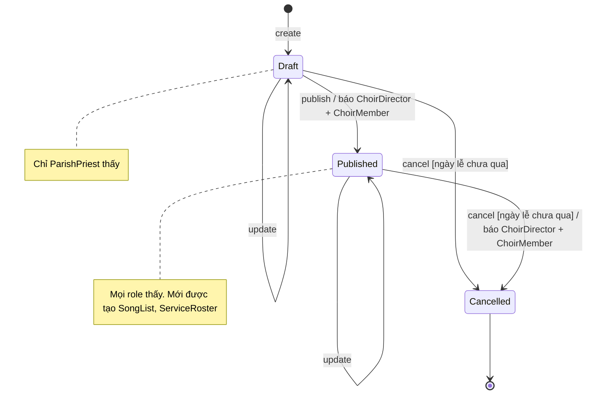
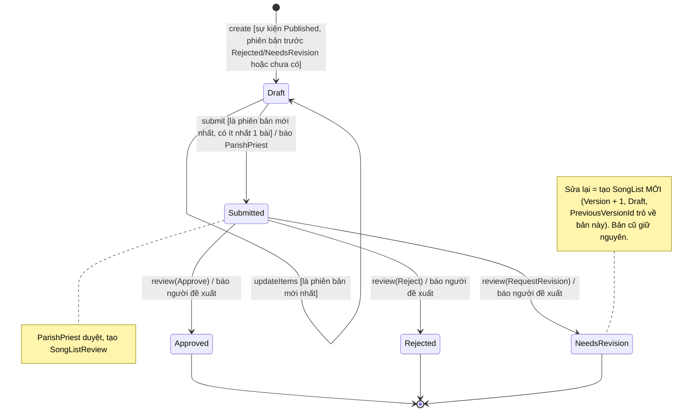
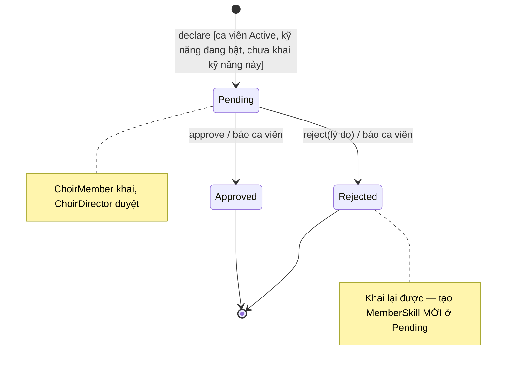
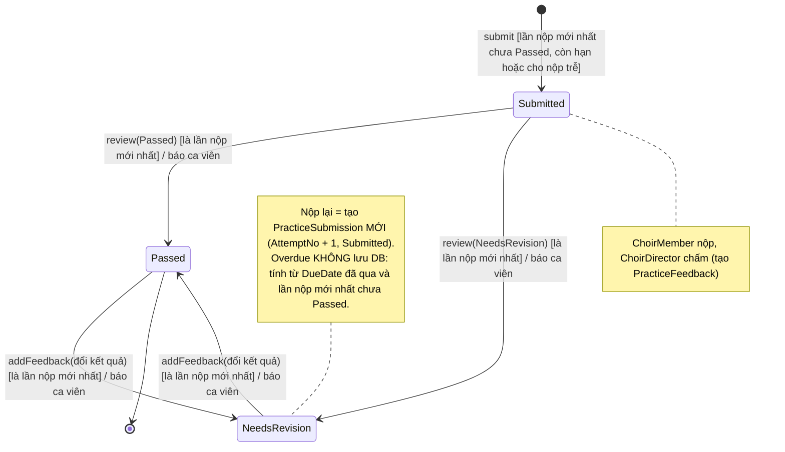
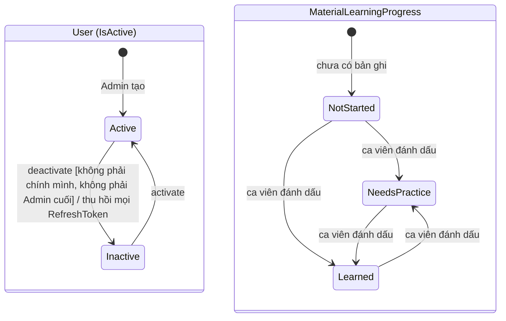
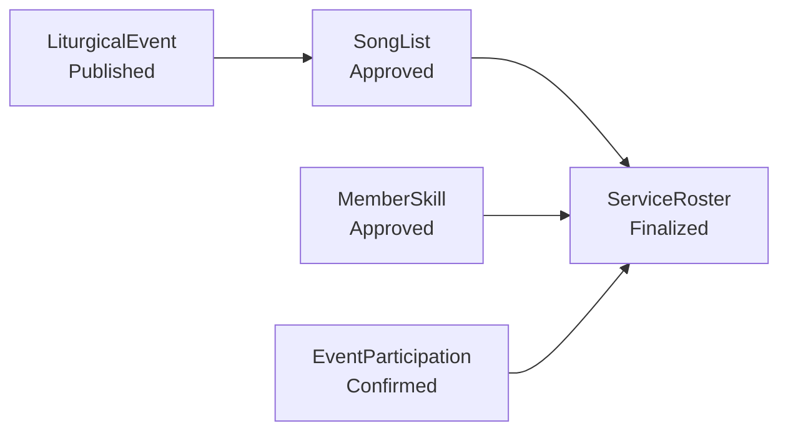

# Hướng dẫn vẽ State Diagram cho Harmonia

Tài liệu này chỉ cách vẽ state diagram (UML State Machine) cho các entity có vòng đời
trong Harmonia, kèm sơ đồ mẫu đã đối chiếu với code ngày 2026-10-12.
Sơ đồ nộp báo cáo thì **vẽ tay** (draw.io, Astah, Visual Paradigm hoặc giấy) theo mục 4.
Các khối Mermaid ở mục 5 chỉ là **hình mẫu để nhìn theo** — mở Markdown Preview trong
VS Code hoặc dán vào <https://mermaid.live> để xem hình.

## 1. Entity nào cần state diagram

Chỉ vẽ cho entity có trường trạng thái **và** có luật chuyển trạng thái trong service.

| Entity | Enum | Vẽ? | Lý do |
|---|---|---|---|
| `LiturgicalEvent` | `EventStatus` | Có | Draft → Published → Cancelled, có guard |
| `SongList` | `SongListStatus` | Có | Luồng đề xuất – duyệt, có phiên bản |
| `ServiceRoster` | `RosterStatus` | Có | Draft / Suggested → Finalized |
| `MemberSkill` | `ApprovalStatus` | Có | Pending → Approved / Rejected |
| `PracticeSubmission` | `SubmissionStatus` | Có | Nộp – chấm – nộp lại |
| `RosterAssignment` | `RosterAssignmentStatus` | Nhỏ | Active → Replaced, gộp vào ghi chú của `ServiceRoster` |
| `User` | `IsActive` (bool) | Nhỏ | Active ⇄ Inactive |
| `MaterialLearningProgress` | `LearningStatus` | Nhỏ | Ca viên tự đổi, không có guard |
| `MemberProfile` | `MemberStatus` | Không | Ca trưởng đặt tự do qua `UpdateAsync`, không có luật chuyển |
| `RehearsalAttendance` | `AttendanceStatus` | Không | Là giá trị điểm danh, không phải vòng đời |
| `EventParticipation` | `ParticipationStatus` | Chưa | Enum có rồi nhưng chưa service nào đổi trạng thái — vẽ khi làm xong chức năng |

## 2. Quy trình vẽ một sơ đồ

1. **Lấy danh sách state** từ enum ở `src/Harmonia.Domain/Enums/<X>Status.cs`.
   Dùng đúng tên enum, không dịch, không đặt từ đồng nghĩa.
2. **Tìm mọi transition**: grep `\.Status = ` trong `src/Harmonia.Application/Services/`
   và `src/Harmonia.Infrastructure/Repositories/`. Mỗi chỗ gán là một mũi tên.
3. **Tìm state khởi đầu**: grep `Status = <Enum>.` trong khối `new <Entity> { ... }`.
4. **Tìm guard**: đọc các dòng `if (...) return Result.Failure(ErrorCodes.X)` đứng trước
   chỗ gán. Điều kiện để đi tiếp là guard; mã lỗi ghi vào bảng bên dưới sơ đồ.
5. **Tìm actor**: xem `[Authorize(Roles = ...)]` của action gọi tới method đó.
6. **Tìm hiệu ứng phụ**: lời gọi `notificationService.SendAsync`, thu hồi token, ghi
   `PublishedAt` / `SubmittedAt` / `DecidedAt`.
7. **Xác định state kết thúc**: state không có chỗ gán nào đi ra. Nối nó tới `[*]`.
8. **Đối chiếu ngược**: mỗi mũi tên phải chỉ được tới một dòng code. Không có dòng code
   thì xoá mũi tên — đừng vẽ theo điều "đáng lẽ phải có".

## 3. Quy ước ký hiệu

Nhãn transition theo dạng UML: `sự kiện [guard] / hành động`.

```
Draft --> Submitted : submit [có ít nhất 1 bài] / báo ParishPriest
```

- **Sự kiện**: động từ ngắn, khớp tên method service bỏ hậu tố `Async` (`submit`, `publish`).
- **Guard**: trong `[ ]`, viết tiếng Việt ngắn. Bỏ nếu không có.
- **Hành động**: sau `/`, chỉ ghi hiệu ứng người dùng thấy được (thông báo, thu hồi token).
- **Actor**: ghi trong `note`, không nhét vào nhãn mũi tên.
- Tên state giữ nguyên tiếng Anh như enum. Chú thích và guard viết tiếng Việt.
- `[*] -->` cho state khởi đầu, `--> [*]` cho state kết thúc.
- Trạng thái **tính ra, không lưu DB** (ví dụ `Overdue`) không vẽ thành state — ghi `note`.
- "Sửa lại" mà thực chất tạo **dòng mới** (phiên bản mới, lần nộp mới) thì không vẽ mũi tên
  quay về `Draft`; state cũ vẫn là kết thúc, ghi `note` rằng một bản ghi mới được tạo.

## 4. Cách vẽ tay

### Hình cần dùng

| Phần tử | Hình vẽ | Trong draw.io (thư viện UML) |
|---|---|---|
| State khởi đầu | Chấm tròn đen đặc | `Start` / Initial state |
| State | Hình chữ nhật **bo góc**, tên state ở giữa | `State` |
| State kết thúc | Chấm đen nằm trong vòng tròn | `End` / Final state |
| Transition | Mũi tên liền, đầu nhọn hở, nhãn đặt sát giữa mũi tên | Connector, kiểu đầu `Open` |
| Tự chuyển (ở lại state cũ) | Mũi tên vòng ra rồi quay về chính state đó | Kéo connector từ state về chính nó |
| Ghi chú | Hình chữ nhật gập góc, nối bằng nét đứt không mũi tên | `Note` |

Không dùng hình thoi, hình chữ nhật góc vuông, hay swimlane — đó là ký hiệu của activity diagram.

### Thứ tự vẽ

1. Lập **bảng transition** trước khi vẽ: bốn cột `Từ | Tới | Sự kiện [guard] | Hành động`,
   mỗi dòng một mũi tên. Bảng đúng thì sơ đồ đúng.
2. Đặt chấm khởi đầu ở **trên cùng bên trái**.
3. Xếp các state của luồng chính thành một hàng dọc (hoặc ngang) theo thứ tự thời gian:
   ví dụ `Draft` → `Submitted` → `Approved`.
4. Đặt các state rẽ nhánh (`Rejected`, `NeedsRevision`, `Cancelled`) lệch sang một bên,
   ngang hàng với state mà chúng tách ra.
5. Vẽ mũi tên luồng chính trước, mũi tên nhánh sau, mũi tên tự chuyển sau cùng.
6. Viết nhãn cho từng mũi tên, lần theo bảng ở bước 1 và đánh dấu dòng đã vẽ.
7. Nối các state không còn đường ra tới một chấm kết thúc đặt ở **dưới cùng**.
   Nhiều state kết thúc có thể dùng chung một chấm.
8. Thêm ghi chú cho actor và cho các điểm dễ hiểu sai (tạo bản ghi mới, trạng thái tính ra).

### Bố cục

- Mũi tên không cắt nhau. Cắt thì dời state, đừng bẻ mũi tên vòng vèo.
- Các state cùng kích thước, căn thẳng hàng.
- Nhãn dài thì xuống dòng sau `[guard]`; không để nhãn đè lên mũi tên khác.
- Mỗi sơ đồ một entity, vừa một trang A4 ngang. Tiêu đề: `State Diagram – <Entity>`.

## 5. Sơ đồ mẫu

### 5.1 `LiturgicalEvent` — `LiturgicalEventService`



| Từ chối | Mã lỗi |
|---|---|
| publish khi đã Published | `LITURGICAL_EVENT_ALREADY_PUBLISHED` |
| update / publish / cancel khi đã Cancelled | `LITURGICAL_EVENT_CANCELLED` |
| cancel khi ngày lễ đã qua | `LITURGICAL_EVENT_ALREADY_PASSED` |

### 5.2 `SongList` — `SongListService`



| Từ chối | Mã lỗi |
|---|---|
| create khi sự kiện chưa Published / đã Cancelled | `LITURGICAL_EVENT_NOT_PUBLISHED` / `LITURGICAL_EVENT_CANCELLED` |
| create khi phiên bản mới nhất đã Approved | `SONG_LIST_EVENT_HAS_APPROVED_VERSION` |
| create khi phiên bản mới nhất còn Draft / Submitted | `SONG_LIST_CANNOT_BE_REVISED` |
| updateItems / submit không phải phiên bản mới nhất | `SONG_LIST_NOT_LATEST_VERSION` |
| updateItems / submit khi không còn Draft | `SONG_LIST_NOT_EDITABLE` / `SONG_LIST_ALREADY_SUBMITTED` |
| submit danh sách rỗng | `SONG_LIST_EMPTY` |
| review khi chưa Submitted | `SONG_LIST_NOT_SUBMITTED` |

### 5.3 `ServiceRoster` — `RosterService`

```mermaid
stateDiagram-v2
    [*] --> Draft : addAssignment (chưa có roster)
    [*] --> Suggested : suggest (chưa có roster)
    Draft --> Suggested : suggest
    Suggested --> Suggested : suggest lại / add / replace / remove assignment
    Draft --> Draft : add / replace / remove assignment
    Draft --> Finalized : finalize [mọi phân công còn hợp lệ]
    Suggested --> Finalized : finalize [mọi phân công còn hợp lệ]
    Finalized --> Finalized : sendNotifications / báo ca viên được phân công
    Finalized --> [*]

    note right of Draft
        Mọi thao tác cần: sự kiện chưa Cancelled, ngày lễ chưa qua,
        có SongList Approved. Chỉ ChoirDirector.
    end note
    note right of Finalized : Không mở lại được. RosterAssignment bị thay: Active → Replaced
```

| Từ chối | Mã lỗi |
|---|---|
| sự kiện Cancelled / đã qua | `LITURGICAL_EVENT_CANCELLED` / `LITURGICAL_EVENT_ALREADY_PASSED` |
| chưa có SongList Approved | `ROSTER_SONG_LIST_NOT_APPROVED` |
| suggest / sửa phân công khi đã Finalized | `ROSTER_ALREADY_FINALIZED` |
| sendNotifications khi chưa Finalized | `ROSTER_NOT_FINALIZED` |

### 5.4 `MemberSkill` — `MemberSkillService`



| Từ chối | Mã lỗi |
|---|---|
| declare khi đã có bản Pending / Approved cùng kỹ năng | `MEMBER_SKILL_ALREADY_DECLARED` |
| declare khi ca viên không Active | `MEMBER_NOT_ACTIVE` |
| declare kỹ năng hoặc nhóm kỹ năng đã tắt | `SKILL_INACTIVE` |
| approve / reject khi không còn Pending | `MEMBER_SKILL_ALREADY_REVIEWED` |

### 5.5 `PracticeSubmission` — `PracticeAssignmentService.SubmitAsync`, `PracticeSubmissionService`



| Từ chối | Mã lỗi |
|---|---|
| submit khi lần mới nhất đã Passed | `PRACTICE_SUBMISSION_ALREADY_PASSED` |
| submit quá hạn, setting không cho nộp trễ | `PRACTICE_SUBMISSION_PAST_DUE` |
| review khi không còn Submitted | `PRACTICE_SUBMISSION_ALREADY_REVIEWED` |
| review / đổi kết quả lần nộp cũ | `PRACTICE_SUBMISSION_SUPERSEDED` |
| addFeedback khi chưa được chấm | `PRACTICE_SUBMISSION_NOT_REVIEWED` |

### 5.6 Các vòng đời nhỏ



## 6. Quan hệ giữa các sơ đồ

`LiturgicalEvent` là hub — trạng thái của nó là guard cho các sơ đồ khác. Khi vẽ sơ đồ
tổng cho báo cáo, thể hiện chuỗi phụ thuộc này:



- `SongList` chỉ tạo được khi `LiturgicalEvent` ở `Published`.
- `ServiceRoster` chỉ lập được khi có `SongList` ở `Approved`.
- Ứng viên phân công phải có `MemberSkill` ở `Approved`, `MemberProfile` ở `Active`
  và `EventParticipation` ở `Confirmed`.
- `LiturgicalEvent` sang `Cancelled` thì khoá toàn bộ nhánh bên phải.

## 7. Checklist trước khi nộp sơ đồ

- [ ] Mọi state trùng tên một giá trị enum trong `Domain/Enums/`.
- [ ] Mọi mũi tên chỉ được tới một dòng gán `Status` trong code.
- [ ] Mọi guard có mã lỗi tương ứng trong `doc/error-codes.md`.
- [ ] Có đúng một `[*] -->` cho mỗi cách tạo bản ghi.
- [ ] State kết thúc không có mũi tên đi ra.
- [ ] Không dùng tên cấm: `ChoirLeader`, `Event`, `Season`, `Assignment`, `Attendance`, `Feedback` trần.
- [ ] Code đổi luật chuyển trạng thái thì sửa sơ đồ trong cùng PR.
