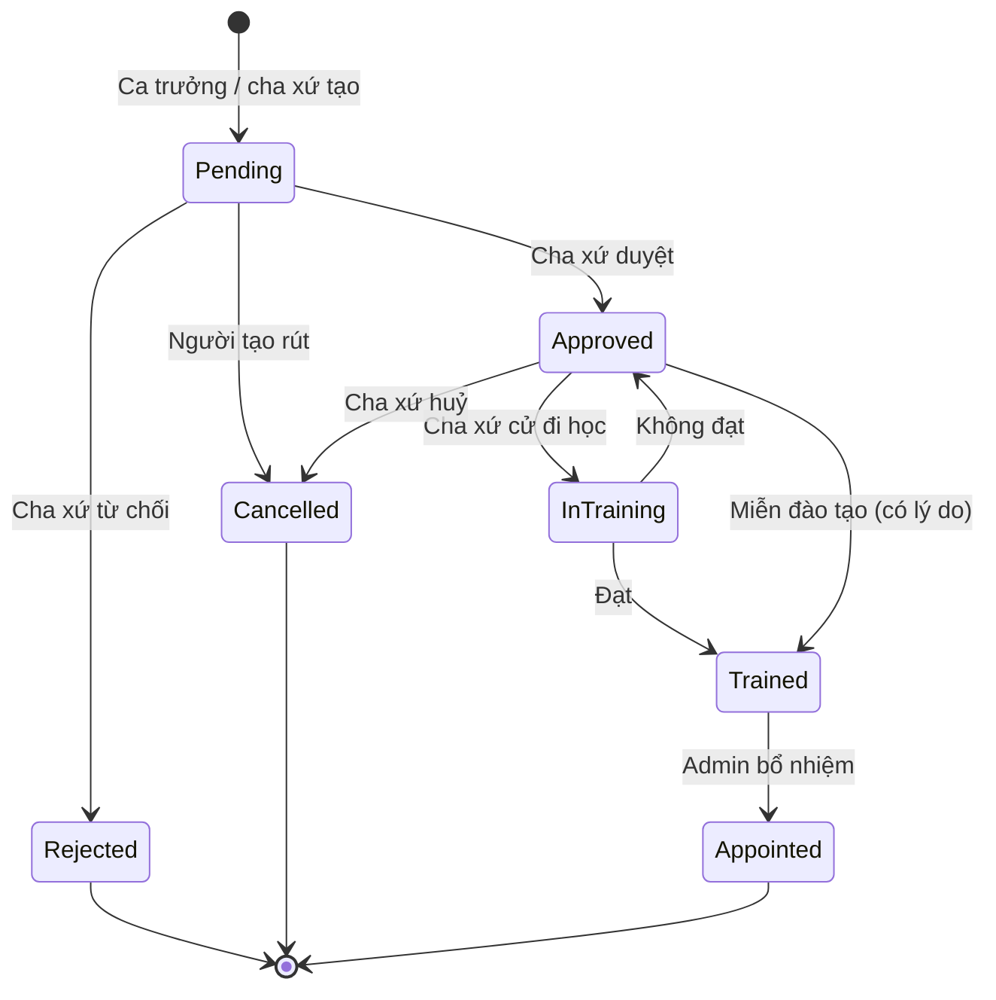
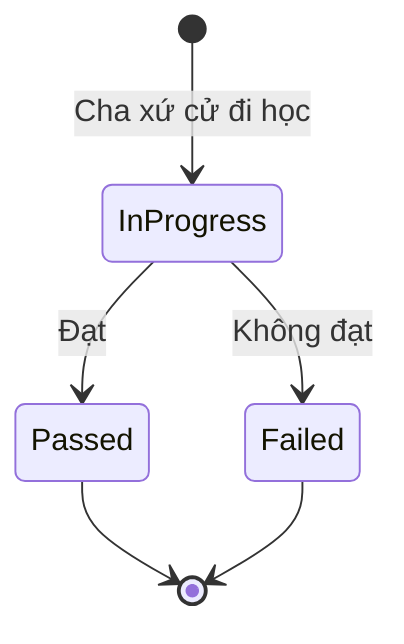

# Quy trình ca viên → ca trưởng

Bản đề xuất ngày 2026-11-09, chưa triển khai. Phần **Còn phải chốt** ở cuối file chưa có quyết định.

## 1. Các bước

| # | Bước | Người làm | Trạng thái |
|---|---|---|---|
| 1 | **Đăng ký qua trang chính**: họ tên, email, số điện thoại, lời nhắn (ví dụ ca đoàn muốn vào) | Người muốn gia nhập (chưa đăng nhập) | Đã làm BE (UC-45), chờ migration |
| 2 | **Xem danh sách đăng ký**, bấm tạo tài khoản `ChoirMember` từ đăng ký (thông tin điền sẵn), server gửi mật khẩu qua email. Đăng ký không hợp lệ thì xoá | Admin | Đã làm BE (UC-45), chờ migration |
| 3 | Đăng nhập lần đầu, đổi mật khẩu | Ca viên | Đã có |
| 4 | Thêm vào ca đoàn (một người có thể ở nhiều ca đoàn) | Ca trưởng của ca đoàn đó | Đã có |
| 5 | Khai báo kỹ năng, nộp minh chứng → ca trưởng duyệt | Ca viên, ca trưởng | Đã có |
| 6 | Đi tập, làm bài tập, phục vụ lễ: tích lũy thành tích | Ca viên | Đã có |
| 7 | **Tạo đề cử**, kèm bảng thành tích và cảnh báo nếu chưa đủ ngưỡng | Ca trưởng (ca viên của ca đoàn mình) hoặc cha xứ (ca viên bất kỳ) | Đã làm BE (UC-46), chờ migration |
| 8 | **Duyệt hoặc từ chối** | Cha xứ | Đã làm BE (UC-46), chờ migration |
| 9 | **Cử đi học** lớp ca trưởng, ghi kết quả; được học nhiều lần hoặc được miễn (bắt buộc ghi lý do) | Cha xứ | Đã làm BE (UC-46), chờ migration |
| 10 | **Bổ nhiệm**: chọn ca đoàn (theo gợi ý, ca đoàn khác hoặc ca đoàn mới), đổi role, gán `Choir.DirectorId` | Admin | Đã làm BE (UC-46), chờ migration |
| 11 | **Bàn giao tự động** (xem bên dưới) | Hệ thống | Đã làm BE |

Đơn offline (điền giấy tại giáo xứ) được chuyển cho Admin. Admin tạo tài khoản trực tiếp như hiện nay, không cần qua bước 1. Ca trưởng của ca đoàn mà người đăng ký đã chọn được báo khi Admin duyệt, để thêm người đó vào ca đoàn ở bước 4.

Ở bước 11, hệ thống tự làm các việc sau:

- Người mới phải đăng nhập lại để nhận quyền ca trưởng (token cũ bị thu hồi).
- Người mới rời các ca đoàn với tư cách ca viên; ca trưởng các ca đoàn đó nhận thông báo.
- Ca trưởng cũ của ca đoàn được giao nhận thông báo và vẫn giữ các ca đoàn khác của mình.
- Buổi tập, danh sách bài và phân công của ca đoàn tự chuyển sang người mới, vì quyền đi theo `Choir.DirectorId`.

## 2. Trạng thái

### Đề cử — `DirectorNomination`

| Mã | Ý nghĩa |
|---|---|
| `Pending` | Chờ duyệt |
| `Approved` | Đã duyệt, chưa đi học hoặc vừa học không đạt |
| `InTraining` | Đang đào tạo |
| `Trained` | Hoàn thành đào tạo hoặc được miễn |
| `Appointed` | Đã bổ nhiệm |
| `Rejected` | Bị từ chối |
| `Cancelled` | Đã huỷ |

### Mỗi lần học — `DirectorTraining`

Mỗi lần học gồm: đề cử, tên khoá, nơi tổ chức, ngày bắt đầu, ngày kết thúc, kết quả, nhận xét, chứng chỉ (tuỳ chọn).

## 3. Luật chính

- Người được đề cử phải có role `ChoirMember` và hồ sơ `Active`. Mỗi người chỉ có **một đề cử đang mở** (`Pending`, `Approved`, `InTraining`, `Trained`).
- Ca trưởng đề cử ca viên ngoài ca đoàn của mình thì trả 404, kiểm qua `IChoirScopeService`.
- Cha xứ tự tạo đề cử thì vẫn đi qua bước `Pending`.
- Mỗi đề cử chỉ có **một lần học đang diễn ra** tại một thời điểm. Kết quả các lần trước được giữ lại.
- Chỉ bổ nhiệm khi đề cử ở `Trained`.
- Người đang học **không** làm được ca trưởng thay thế của sự kiện, vì chức năng `substitute-director` đòi role `ChoirDirector`.
- Hệ thống không tự hạ role ca trưởng cũ, và chặn việc hạ role ca trưởng khi người đó vẫn còn phụ trách ca đoàn.
- Hệ thống không quản lý lớp học. Lớp do giáo phận tổ chức, hệ thống chỉ ghi lại việc cử đi học và kết quả.

**Ngưỡng thành tích** — chỉ cảnh báo, không chặn; Admin chỉnh được trong `SystemSetting`:

| Tiêu chí | Ngưỡng | Lấy từ |
|---|---|---|
| Thâm niên ở ca đoàn đề cử | ≥ 2 năm | `ChoirMembership.JoinedDate` |
| Tỷ lệ đi tập, 12 tháng gần nhất | ≥ 80% | `RehearsalAttendance` |
| Số lễ đã phục vụ | ≥ 20 | `RosterAssignment` |
| Kỹ năng hỗ trợ điều khiển | Đã duyệt | `MemberSkill` thuộc `SkillCategory` = Conducting support |

**Chứng chỉ:** nhận `.pdf`, `.jpg`, `.png`, tối đa 20 MB, lưu private.

## 4. Phân quyền

| Thao tác | Admin | Cha xứ | Ca trưởng | Ca viên |
|---|---|---|---|---|
| Tạo đề cử | | ✓ | ✓ (ca đoàn mình) | |
| Rút đề cử | | ✓ (của mình) | ✓ (của mình) | |
| Duyệt, từ chối, huỷ, miễn đào tạo | | ✓ | | |
| Cử đi học, ghi kết quả | | ✓ | | |
| Bổ nhiệm | ✓ | | | |
| Xem đề cử và lịch sử học | ✓ | ✓ | ✓ (đề cử mình tạo) | ✓ (của chính mình) |
